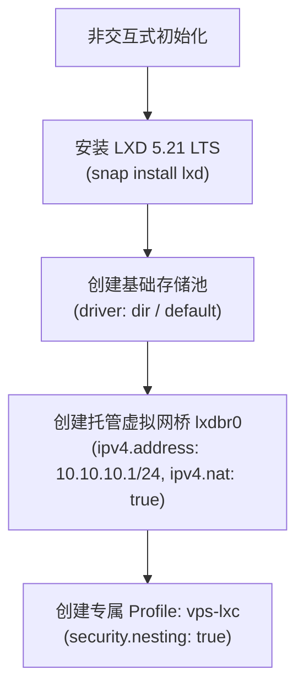

# 2.1 LXD 5.21 架构设计、虚拟网桥配置与专用 Profile 隔离

> **深入 Canonical LXD 容器底层，掌握静默非交互式初始化、`lxdbr0` NAT 网桥原理，以及独立专有 Profile 与 Docker 嵌套虚拟化配置。**

---

## 一、 LXD 架构与非交互式初始化

在自动化运维体系中，不能依赖交互式的 `lxd init` 问答向导，必须通过预定义的 YAML 配置或 CLI 指令完成静默初始化：



### 1. 静默初始化脚本范例

```bash
#!/usr/bin/env bash
set -euo pipefail

# 1. 确保安装 LXD 5.21 LTS 长期支持版
if ! command -v lxd &>/dev/null; then
    echo "正在安装 LXD 5.21 LTS..."
    sudo snap install lxd --channel=5.21/stable
fi

# 2. 初始化存储池（采用通用性最广的 dir 驱动）
if ! lxc storage show default &>/dev/null; then
    echo "创建默认存储池 default (dir 模式)..."
    lxc storage create default dir
fi

# 3. 初始化托管网桥 lxdbr0
if ! lxc network show lxdbr0 &>/dev/null; then
    echo "创建私网 NAT 网桥 lxdbr0..."
    lxc network create lxdbr0 \
        ipv4.address=10.10.10.1/24 \
        ipv4.nat=true \
        ipv6.address=none
fi
```

---

## 二、 独立 Profile 设计与 Docker 嵌套权限（PR #3 避坑）

### 1. [关键踩坑] 绝不污染宿主机的 `default` Profile！

在早期的自动化设计中，许多脚本直接修改 LXD 自带的 `default` Profile。当宿主机本身已经部署了其他业务容器或老旧服务时，修改 `default` Profile 极易引发连锁崩溃。此外，在旧版本 LXD 中执行 `lxc profile show` 时，缺少 `--format` 参数会导致解析脚本意外退出。

**工业级解决方案**：
* 坚决保留宿主机原始的 `default` Profile 不动；
* 为业务集群创建**全新的专属 Profile（如 `vps-lxc`）**，所有由引擎派生的容器只绑定此专属 Profile。

### 2. 开启 `security.nesting=true`（容器内运行 Docker）

为了支持在 LXC 容器内部再次运行 Docker 容器（如运行 Web 监控、DUIX 离线数字人或定制镜像），必须在 Profile 中注入嵌套权限：

```bash
# 创建并配置专属 profile
lxc profile create vps-lxc || true

# 绑定根磁盘与网桥
lxc profile device add vps-lxc root disk path=/ pool=default || true
lxc profile device add vps-lxc eth0 nic network=lxdbr0 name=eth0 || true

# 开启容器内 Docker 嵌套与特权能力
lxc profile set vps-lxc security.nesting=true
```

---

## 三、 NAT 端口转发陷阱与探测盲区（PR #5 避坑）

在实现宿主机到容器的端口穿透时，LXD 提供了一种极其高效的 `proxy` 设备模式：

```bash
# 将宿主机 2201 端口直通映射到容器 c1 的 22 端口
lxc config device add c1 ssh-in proxy \
    listen=tcp:0.0.0.0:2201 \
    connect=tcp:127.0.0.1:22
```

### [重大踩坑复盘] 为什么 `ss -tulpn` 会漏报已占用的 NAT 端口？

> [!WARNING]
> 当用户尝试在已运行业务的“繁忙宿主机（Busy Host）”上扩容新容器时，脚本如果仅依赖 `ss -tulpn` 或 `netstat` 检测宿主机端口空闲状态，**会产生致命的误判**！
> 
> **原因分析**：
> 某些 Linux 发行版或内核在通过 iptables PREROUTING / NAT 转发端口时，宿主机内核空间并不存在处于 `LISTEN` 状态的 Local Socket！
> 
> **工程解决方案**：
> 端口冲突校验必须执行**双层验证**：
> 1. 第一层：`ss -tulpn` 检查本地宿主机进程监听；
> 2. 第二层：**遍历所有已有容器的 `devices` 配置**，提取已存在的 proxy 设备监听端口，两层求并集，确保新容器分配的端口矩阵绝对不产生碰撞。

---

## 🔗 参考资料

* **Canonical LXD 网络配置指南**：[LXD Network Configuration](https://documentation.ubuntu.com/lxd/en/latest/reference/network_bridge/)
* **LXD Proxy 设备协议直通规范**：[LXD Device Type Proxy](https://documentation.ubuntu.com/lxd/en/latest/reference/devices_proxy/)
