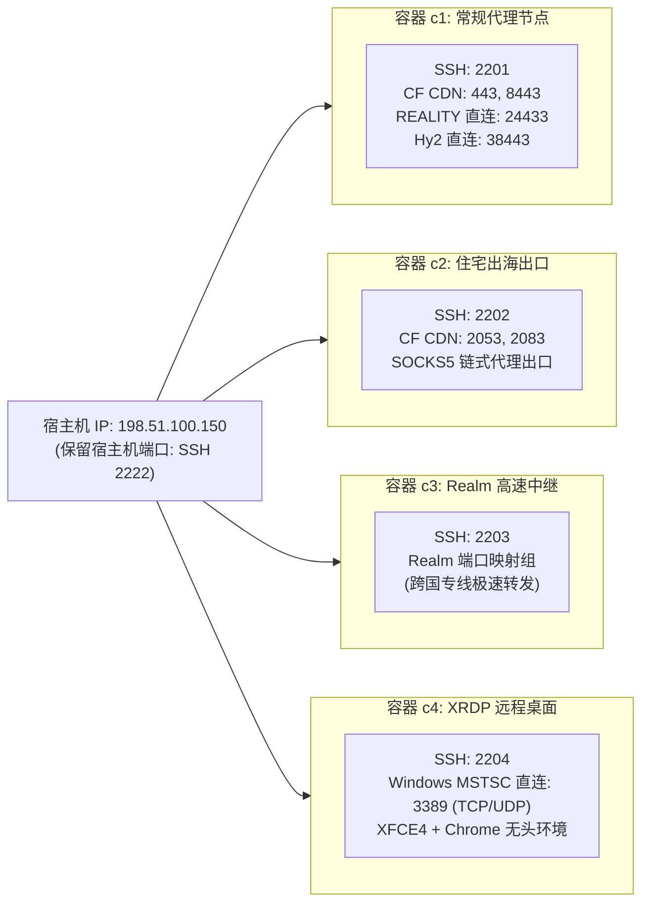

# 2.2 四容器黄金拓扑规划、Cloudflare 端口矩阵与纯净度规范

> **详细规划生产级 4 容器黄金架构，剖析 Cloudflare 官方 CDN 端口映射分配法，确立容器零污染与信息集中归档原则。**

---

## 一、 4 容器生产级功能拓扑与分工

在单台 2-4 vCPU、4GB 内存的 VPS 宿主机（如 `198.51.100.150`）上，推荐构建如下标准化的 4 容器集群：

---

## 二、 Cloudflare 官方 CDN 端口矩阵映射原理

Cloudflare 免费版与 Pro 版 Anycast CDN 仅代理指定的有限 HTTP/HTTPS 端口。为了让集群中的多个独立容器都能享受 Cloudflare CDN 加速与防墙复活能力，必须将官方支持的 HTTPS 端口科学地切割分配至各容器：

| Cloudflare 支持的 HTTPS 端口 | 对应映射容器 | 承载业务协议与规划用途 |
| :--- | :--- | :--- |
| **TCP 443** | **容器 c1** | **核心代理主站**：VLESS-WS-TLS 443 端口直连与 CDN 回源 |
| **TCP 8443** | **容器 c1** | **c1 备用端口 / 独立 Web 管理入口** |
| **TCP 2053** | **容器 c2** | **住宅出海节点入口 1**：通过 Cloudflare 隐藏 c2 宿主真实 IP |
| **TCP 2083** | **容器 c2** | **住宅出海节点入口 2**：备用 CDN 回源通道 |
| **TCP 2087 / 2096** | **预留池** | 预留给后续动态扩展的 c5、c6 容器或面板访问 |

> [!TIP]
> **关于自定义域名的无端口访问（Origin Rules）**：
> 虽然容器 c2 监听的是宿主机的 2053 或 2083 端口，但借助 Cloudflare 的 **Origin Rules（回源规则）**，用户在客户端访问 `https://c2.yourdomain.com`（标准 443 端口）时，Cloudflare 边缘节点会自动将流量重写回源到服务器的 2053 端口，客户端完全无需携带复杂的端口后缀！

---

## 三、 原生 RDP 3389 直连设计（容器 c4）

容器 c4 专属用于出海业务运营、跨境电商防关联登录与无头爬虫：
1. **宿主机 3389 直通映射**：将宿主机的公网 `3389`（TCP 与 UDP 双栈）通过 LXD proxy 映射至 c4 容器；
2. **免端口连接**：Windows 用户打开系统的“远程桌面连接”（`mstsc.exe`），直接输入宿主机 IP（如 `198.51.100.150`），无需输入任何端口号即可一键登录 XFCE4 桌面；
3. **内存与 Swap 兜底**：c4 容器分配 1024MB 内存配比，并通过宿主机的 2GB Swap 与 `vm.swappiness=10` 保障浏览器突发多开时不被 OOM Killer 杀掉进程。

---

## 四、 容器纯净度原则与信息集中归档规范

在历史排错与代码审计中，我们曾发现许多自动化脚本喜欢在容器内部写入各类 `README.md`、临时脚本或密码文件。这不仅破坏了容器系统的纯净性，还在多租户或分享环境下产生了极大的密码泄露隐患。

### 1. 容器零污染规范
* **标准镜像直出**：容器镜像采用官方纯净 `ubuntu-minimal:24.04` 或 `debian/13`；
* **统一主机名**：所有容器的内部 Hostname 统一设置为标准 `vps`，消除编号后缀，避免环境指纹泄露；
* **极简 MOTD 欢迎标语**：剔除任何包含物理宿主机硬件信息的花哨 Banner；
* **容器内无敏感文档**：容器内部不留存任何包含其他容器或宿主机 IP、密码的文本。

### 2. 宿主机集中化归档体系
所有容器的独立随机 Root 密码、端口映射表、SSH 登录命令全部结构化保存在宿主机的专有目录下：
* 路径规范：`/root/02project/01LXD_vps_info/<HOST_IP>/cluster_info.json`
* 权限管控：该目录强制设置为 `chmod 0700`，凭据文件强制设置为 `chmod 0600`，杜绝非授权用户读取。

---

## 🔗 参考资料

* **Cloudflare 官方支持网络端口清单**：[Cloudflare Supported Network Ports](https://developers.cloudflare.com/fundamentals/reference/network-ports/)
* **Cloudflare Origin Rules 配置指南**：[Cloudflare Origin Rules Documentation](https://developers.cloudflare.com/rules/origin-rules/)
