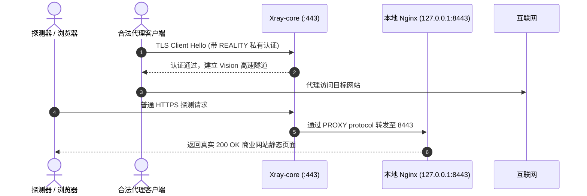

# 3.1 单端口 443 终极伪装方案：Xray PROXY Protocol 回落真实 Nginx

> **剖析 `reality-self` 模式的流量分流底层，实现合法客户端极速代理、扫描与探测回落真实静态站点的闭环防御。**

---

## 一、 为什么自建伪装站（`reality-self`）优于偷取他人证书？

传统的 VLESS-REALITY 通常采用“偷借”大型跨国科技公司（如 Mozilla、Apple、Yahoo）的 SNI 和证书公钥。这种方式虽然简单，但在面对深度包检测（DPI）与主动探测时仍有局限：
* **IP 归属地与证书不匹配**：若探测器顺着目标 IP 访问 HTTPS，但该 IP 所属 ASN 并非目标大厂 ASN，容易被风控标记；
* **TLS 握手特征探测**：某些主动探测器会故意发送特异的 TLS Client Hello，观察服务端返回的证书链路与 HTTP 行为。

**`reality-self` 的终极解决方案**：
* 整个系统**独占公网 443 端口**；
* 该域名由你真实持有，并利用 ACME 自动化签发**真实的 Let's Encrypt / ZeroSSL 机构 ECC 证书**；
* 443 端口由 Xray 监听：具备合法私钥的客户端直接走 Vision 流控出网；任何其他 HTTP/HTTPS 请求，全部通过 **PROXY protocol 协议**原封不动地转交至本地 `127.0.0.1:8443` 的 Nginx，呈现一个真实的个人博客或企业官网。

---

## 二、 流量分流链路与配置契约



### 1. Xray-core 回落配置片段

在 Xray 的 inbound 配置中，核心在于定义 `fallbacks` 数组：

```json
{
  "inbounds": [
    {
      "port": 443,
      "protocol": "vless",
      "settings": {
        "clients": [
          {
            "id": "00000000-0000-0000-0000-000000000001",
            "flow": "xtls-rprx-vision"
          }
        ],
        "decryption": "none",
        "fallbacks": [
          {
            "dest": "127.0.0.1:8443",
            "xver": 1
          }
        ]
      },
      "streamSettings": {
        "network": "tcp",
        "security": "reality",
        "realitySettings": {
          "show": false,
          "dest": "127.0.0.1:8443",
          "xver": 1,
          "serverNames": [
            "node.yourdomain.com"
          ],
          "privateKey": "YOUR_REALITY_PRIVATE_KEY_PLACEHOLDER",
          "shortIds": [
            "0123456789abcdef"
          ]
        }
      }
    }
  ]
}
```

### 2. 本地 Nginx 配合 PROXY Protocol 配置

Nginx 需要启用 `proxy_protocol` 监听，并还原客户端的真实 IP：

```nginx
server {
    listen 127.0.0.1:8443 ssl proxy_protocol;
    server_name node.yourdomain.com;

    # 还原真实客户端 IP
    set_real_ip_from 127.0.0.1;
    real_ip_header proxy_protocol;

    # 挂载真实 ACME 证书
    ssl_certificate /etc/letsencrypt/live/node.yourdomain.com/fullchain.pem;
    ssl_certificate_key /etc/letsencrypt/live/node.yourdomain.com/privkey.pem;

    ssl_protocols TLSv1.2 TLSv1.3;
    ssl_ciphers HIGH:!aNULL:!MD5;

    root /var/www/html;
    index index.html;

    location / {
        try_files $uri $uri/ =404;
    }
}

# 80 端口用于 ACME Challenge 验证与 301 重定向
server {
    listen 80;
    server_name node.yourdomain.com;

    location /.well-known/acme-challenge/ {
        root /var/www/html;
    }

    location / {
        return 301 https://$host$request_uri;
    }
}
```

---

## 三、 连通性与回落验证指南

在服务器部署完毕后，可通过两步验证回落是否严丝合缝：

```bash
# 1. 验证常规探测（应返回 200 OK 与自建站点 HTML）
curl -v -k --resolve node.yourdomain.com:443:127.0.0.1 https://node.yourdomain.com

# 2. 验证本地 Nginx 访问日志是否记录到了 PROXY 传递的真实 IP
tail -n 20 /var/log/nginx/access.log
```

---

## 🔗 参考资料

* **Project X Fallbacks 官方技术白皮书**：[Xray Fallbacks Specification](https://xtls.github.io/config/inbounds/vless.html#fallbacks)
* **Nginx PROXY Protocol 官方模块文档**：[Module ngx_http_realip_module](https://nginx.org/en/docs/http/ngx_http_realip_module.html)
