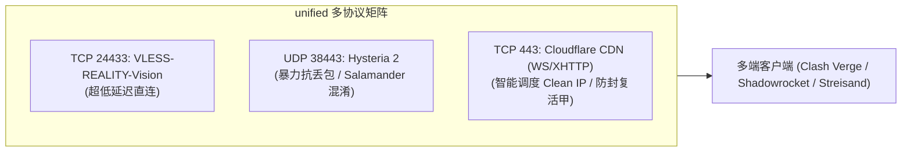

# 3.2 多协议共存、后量子密码 ML-KEM 握手踩坑与 SQLite 单事务保障

> **掌握 `unified` 多协议共存设计，攻克 Mihomo / Clash Verge 在 Xray 下的后量子密码（ML-KEM-768）握手兼容陷阱，实现 3X-UI 数据库单事务原子操作与故障回滚。**

---

## 一、 `unified` 多协议共存矩阵设计

在实际生产场景中，单一协议无法应对复杂的跨运营商网络环境。`unified` 模式通过端口解耦实现三大主力协议的和谐共生：

| 协议类型 | 传输层与端口 | 核心技术特性 | 适用运营商与网络场景 |
| :--- | :--- | :--- | :--- |
| **VLESS-REALITY-Vision** | TCP `24433` (无域名时可用 443) | 原生 TLS 流控，免证书伪装 | 晚高峰低抖动、电信与联通首选 |
| **Hysteria 2** | UDP `38443` | 基于 QUIC/UDP，集成 Salamander 混淆 | 恶劣高丢包环境、移动宽带、手机端 |
| **Cloudflare CDN VLESS** | TCP `443` (WebSocket / XHTTP) | 经 Cloudflare Anycast CDN 代理回源 | IP 被墙时的复活甲、全天候兜底通道 |



---

## 二、 后量子密码（ML-KEM-768）握手踩坑实录（PR #14 核心复盘）

### 1. 现象复现：为什么 Clash Verge 导入节点后无法连接？

在测试日本 IIJ（`198.51.100.150`）或软银（`203.0.113.186`）的 VLESS-REALITY 节点时，用户常常反馈：
> “使用手机 Streisand 能够连上，但在电脑端使用 Clash Verge Rev 时，节点延迟显示 Timeout 或握手失败，日志报错：`handshake error: remote error: tls: handshake failure`。”

### 2. 根因深度剖析

随着现代密码学向抗量子计算演进，**Xray-core 服务端与 Go 1.23+ 默认启用了混合后量子密钥交换机制（X25519 + ML-KEM-768）**。
* **Mihomo / Clash 内核兼容性门槛**：客户端必须运行在 `minClientVer: 1.8.0` 或更高版本；
* **显式协商参数缺失**：如果 VLESS 节点的分享链接中未携带后量子协商指令，客户端在发起 TLS Client Hello 时将无法匹配服务端的 Cipher Suites，导致 TLS 握手在首个包即被阻断！

### 3. 工业级解决方案

在生成的 VLESS 分享链接中，必须强制追加 `support-x25519mlkem768=true` 参数：

```text
vless://00000000-0000-0000-0000-000000000001@198.51.100.150:24433?encryption=none&flow=xtls-rprx-vision&security=reality&sni=addons.mozilla.org&fp=chrome&pbk=YOUR_PUBLIC_KEY&sid=0123456789abcdef&type=tcp&headerType=none&support-x25519mlkem768=true#Japan-IIJ-REALITY-Direct
```

对应到 Clash / Mihomo 的 YAML 节点配置：

```yaml
- name: "Japan-IIJ-REALITY-Direct"
  type: vless
  server: 198.51.100.150
  port: 24433
  uuid: 00000000-0000-0000-0000-000000000001
  network: tcp
  udp: true
  tls: true
  flow: xtls-rprx-vision
  servername: addons.mozilla.org
  reality-opts:
    public-key: YOUR_PUBLIC_KEY
    short-id: 0123456789abcdef
  client-fingerprint: chrome
```

---

## 三、 3X-UI SQLite 数据库并发锁与单事务保障（PR #8 核心复盘）

3X-UI 面板底层采用 SQLite 保存所有 Inbounds（入站规则）与客户端设置。在多 Agent 协同或脚本频繁调用时，极易触发 `database is locked` 异常导致数据损坏。

### 单事务原子更新与自动回滚设计

在自动化运维脚本中，必须实现“原子备份 -> 单事务写入 -> 端口监听核验 -> 失败自动回滚”闭环：

```python
import sqlite3
import shutil

DB_PATH = "/etc/x-ui/x-ui.db"
BACKUP_PATH = "/etc/x-ui/x-ui.db.bak"

def atomic_update_inbound(sql_commands):
    # 1. 强制生成快照备份
    shutil.copy2(DB_PATH, BACKUP_PATH)
    
    conn = sqlite3.connect(DB_PATH, timeout=30.0)
    cursor = conn.cursor()
    try:
        # 2. 单事务执行全部注入
        cursor.execute("BEGIN TRANSACTION;")
        for sql, params in sql_commands:
            cursor.execute(sql, params)
        conn.commit()
        print("数据库入站规则写入成功！")
    except Exception as e:
        conn.rollback()
        # 3. 失败时立即从快照还原
        shutil.copy2(BACKUP_PATH, DB_PATH)
        raise RuntimeError(f"数据库写入异常，已自动回滚备份: {e}")
    finally:
        conn.close()
```

---

## 🔗 参考资料

* **IETF Draft: X25519MLKEM768 Hybrid Post-Quantum Key Exchange**：[IETF Draft tls-hybrid-design](https://datatracker.ietf.org/doc/draft-ietf-tls-hybrid-design/)
* **SQLite 事务隔离与锁机制官方文档**：[SQLite Transaction Isolation](https://www.sqlite.org/isolation.html)
* **Hysteria 2 官方部署与 Salamander 混淆规范**：[Hysteria 2 Quick Start](https://v2.hysteria.network/docs/quick-start/)
