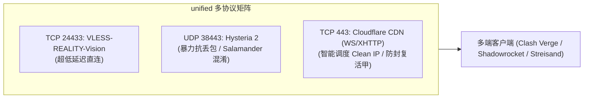

# 3.2 多协议共存、后量子密码 ML-KEM 握手踩坑与 SQLite 单事务保障

> **掌握 `unified` 多协议共存设计，攻克 Mihomo / Clash Verge 在 Xray 下的后量子密码（ML-KEM-768）握手兼容陷阱，实现 3X-UI 数据库单事务原子操作与故障回滚。**

---

## 一、 `unified` 多协议共存矩阵设计

在实际生产场景中，单一协议无法应对复杂的跨运营商网络环境。`unified` 模式通过端口解耦实现三大主力协议的和谐共生：

| 协议类型 | 传输层与端口 | 核心技术特性 | 适用运营商与网络场景 |
| :--- | :--- | :--- | :--- |
| **VLESS-REALITY-Vision** | TCP `24433` (无域名时可用 443) | 原生 TLS 流控，免证书伪装 | 晚高峰低抖动、电信与联通首选 |
| **Hysteria 2** | UDP `38443` | 基于 QUIC/UDP，集成 Salamander 混淆 | 恶劣高丢包环境、移动宽带、手机端 |
| **Cloudflare CDN VLESS** | TCP `443` (WebSocket / XHTTP) | 经 Cloudflare Anycast CDN 代理回源 | IP 被墙时的复活甲、全天候兜底通道 |



---

## 二、 客户端兼容性、后量子密码陷阱与 universal 握手实录

### 1. 现象复现：为什么追加后量子参数反而导致全网客户端报 `-1`？

在早期方案中，曾尝试针对部分高版本 Mihomo 追加 `support-x25519mlkem768=true` 并将 3X-UI 入站的 `minClientVer` 设为 `1.8.0`。然而在多环境真实测试中，引发了严重的客户端连锁崩溃：
* **v2rayN 普遍报 `-1` / 握手失败**：主流 Windows v2rayN（搭载标准 Xray-core 1.8.x）无法兼容非标准查询参数或后量子密码握手协商，测试直接报 `-1` 超时；
* **在线订阅转换接口全线崩溃**：将带 `support-x25519mlkem768=true` 的节点链接提交给标准订阅转换 API（如 onepage、v1.mk）时，解析引擎因无法识别非标参数直接报错或生成断链；
* **3X-UI `minClientVer` 静默拒连**：当客户端未严格在 TLS Client Hello 中上报版本头，服务端直接静默将合法请求丢弃或回落至伪装网站！

### 2. 根因剖析与工业级解决方案

真正的跨平台高可用网络，核心在于**向下兼容与标准收敛**，而非盲目启用破坏兼容性的实验性特性：

1. **入站版本解除硬编码 (`minClientVer: ""`)**：
   在 3X-UI SQLite 数据库的入站 `stream_settings.realitySettings` 中，将 `minClientVer` 清空为 `""`，允许所有标准客户端版本自由握手。
2. **剔除实验性参数，回归标准 X25519**：
   从所有 VLESS 分享链接和 Clash 配置中彻底剥离 `support-x25519mlkem768`，采用全球事实标准的通用 X25519 椭圆曲线交换。这样无论 v2rayN、Mihomo / Clash Verge Rev、Sing-box、Shadowrocket 还是在线转换器均能 100% 顺畅解析。
3. **锁定稳定黄金内核版本 (`v26.6.27`)**：
   Xray-core 自 `v26.7.11` 起修改了 REALITY 的 AEAD 握手校验，导致部分客户端触发 `REALITY authentication failed`。锁定 `v26.6.27` 既能支持 3X-UI 最新入站特性，又能保持全平台最佳握手兼容。

标准、全客户端通用的 VLESS-REALITY 分享链接规范：

```text
vless://00000000-0000-0000-0000-000000000001@198.51.100.150:20159?encryption=none&flow=xtls-rprx-vision&security=reality&sni=addons.mozilla.org&fp=chrome&pbk=YOUR_PUBLIC_KEY&sid=0123456789abcdef&type=tcp#Japan-REALITY-Direct
```

对应全平台兼容的 Clash / Mihomo YAML 节点配置：

```yaml
- name: "Japan-REALITY-Direct"
  type: vless
  server: 198.51.100.150
  port: 20159
  uuid: 00000000-0000-0000-0000-000000000001
  network: tcp
  udp: true
  tls: true
  flow: xtls-rprx-vision
  servername: addons.mozilla.org
  reality-opts:
    public-key: YOUR_PUBLIC_KEY
    short-id: 0123456789abcdef
  client-fingerprint: chrome
```

---

## 三、 3X-UI SQLite 数据库并发锁与单事务保障（PR #8 核心复盘）

3X-UI 面板底层采用 SQLite 保存所有 Inbounds（入站规则）与客户端设置。在多 Agent 协同或脚本频繁调用时，极易触发 `database is locked` 异常导致数据损坏。

### 单事务原子更新与自动回滚设计

在自动化运维脚本中，必须实现“原子备份 -> 单事务写入 -> 端口监听核验 -> 失败自动回滚”闭环：

```python
import sqlite3
import shutil

DB_PATH = "/etc/x-ui/x-ui.db"
BACKUP_PATH = "/etc/x-ui/x-ui.db.bak"

def atomic_update_inbound(sql_commands):
    # 1. 强制生成快照备份
    shutil.copy2(DB_PATH, BACKUP_PATH)
    
    conn = sqlite3.connect(DB_PATH, timeout=30.0)
    cursor = conn.cursor()
    try:
        # 2. 单事务执行全部注入
        cursor.execute("BEGIN TRANSACTION;")
        for sql, params in sql_commands:
            cursor.execute(sql, params)
        conn.commit()
        print("数据库入站规则写入成功！")
    except Exception as e:
        conn.rollback()
        # 3. 失败时立即从快照还原
        shutil.copy2(BACKUP_PATH, DB_PATH)
        raise RuntimeError(f"数据库写入异常，已自动回滚备份: {e}")
    finally:
        conn.close()
```

---

## 🔗 参考资料

* **IETF Draft: X25519MLKEM768 Hybrid Post-Quantum Key Exchange**：[IETF Draft tls-hybrid-design](https://datatracker.ietf.org/doc/draft-ietf-tls-hybrid-design/)
* **SQLite 事务隔离与锁机制官方文档**：[SQLite Transaction Isolation](https://www.sqlite.org/isolation.html)
* **Hysteria 2 官方部署与 Salamander 混淆规范**：[Hysteria 2 Quick Start](https://v2.hysteria.network/docs/quick-start/)
