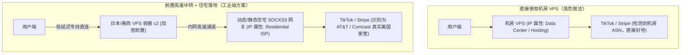

# 4.1 跨境出海住宅代理链式转发与 QUIC 泄漏防御

> **构建“前置 VPS 高速加密中转 + 纯净住宅 ISP 落地”链式代理，掌握 Xray 路由规则中的 `exit_all` 设计与 UDP/QUIC 强制阻断防漏机制。**

---

## 一、 链式代理架构设计与出海防封优势

针对海外社媒矩阵、跨境电商与金融机构，直接使用 VPS 机房 IP 或廉价机场节点面临着极高的封禁概率：



### 链式代理的核心价值
1. **客户端网络体验极佳**：用户端到 VPS 的连接受到 BBR 拥塞控制与 TLS 伪装保护，避免了客户端直接连接住宅代理时的频繁丢包与高延迟；
2. **目标平台识别为真实家庭宽带**：目标平台检测到的 IP 完全隶属于 Comcast、AT&T、Spectrum 等本土住宅宽带服务商，欺诈风控评分（Fraud Score）极低；
3. **隔离运维风险**：按量计费的住宅代理凭据完全托管在服务端的 Xray 路由中，客户端无需暴露住宅账号密钥。

---

## 二、 [致命陷阱] UDP/QUIC 旁路泄露与 `exit_all` 根治方案（PR #14 核心复盘）

### 1. 为什么配置了住宅代理依然被识别为机房？

在真实的排查中，许多跨境卖家反映：
> “我的代理规则已经把出站指向了 SOCKS5 住宅网关，为什么登录 TikTok 时仍然被提示环境风险？”

**根因曝光：HTTP/3 QUIC 绕道泄露**：
* 绝大多数商业住宅代理服务商（如 IPRoyal、BrightData、Smartproxy）**仅支持 TCP 协议（HTTP/SOCKS5）**，不支持或会静默丢弃 UDP 数据包；
* 现代 Chrome 浏览器与 TikTok App 默认会优先尝试通过 **UDP 443（QUIC / HTTP3）** 发起握手；
* 如果 Xray 的路由规则不够严密，当 UDP 流量尝试走住宅出站失败后，**系统可能会自动回退至直接出站（direct）**！此时，浏览器的 QUIC 数据包直接通过宿主机公网网卡发出，瞬间暴露了宿主机的机房 IP。

### 2. `exit_all` 严密路由与 QUIC 强制封锁策略

在 `vps-deploy-skill` 的 PR #14 中，工程团队推出了彻底杜绝泄漏的 `exit_all` 路由规范：

```json
{
  "routing": {
    "domainStrategy": "IPIfNonMatch",
    "rules": [
      {
        "type": "field",
        "port": "443",
        "network": "udp",
        "outboundTag": "block_quic"
      },
      {
        "type": "field",
        "inboundTag": ["in-residential-chain"],
        "outboundTag": "residential_socks_out"
      }
    ]
  },
  "outbounds": [
    {
      "tag": "block_quic",
      "protocol": "blackhole"
    },
    {
      "tag": "residential_socks_out",
      "protocol": "socks",
      "settings": {
        "servers": [
          {
            "address": "res-gw.example-proxy.com",
            "port": 1080,
            "users": [
              {
                "user": "residential_user_demo",
                "pass": "residential_pass_demo"
              }
            ]
          }
        ]
      }
    }
  ]
}
```

> [!IMPORTANT]
> **关键防御动作**：
> 1. 将所有发往 UDP 443 的流量路由至 `blackhole`（黑洞）；
> 2. 当浏览器发现 UDP 443 无法连通时，会**强制回退至 HTTP/2（标准 TCP TLS）**；
> 3. 全部 TCP 流量均受限通过 `residential_socks_out` 出站，绝无直接流出宿主机公网的可能！

---

## 🔗 参考资料

* **IETF RFC 9000 (QUIC: A UDP-Based Multiplexed and Secure Transport)**：[RFC 9000 Specification](https://www.rfc-editor.org/rfc/rfc9000.html)
* **Project X Outbound Protocols & Routing Rules**：[Xray Routing Rules Guide](https://xtls.github.io/config/routing.html)
