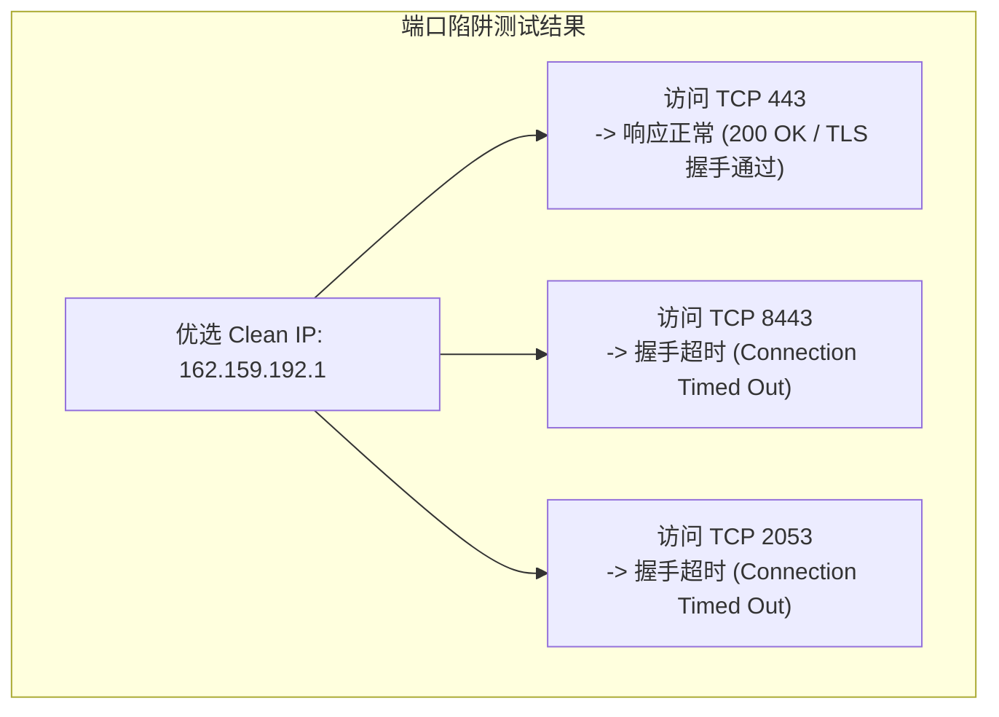
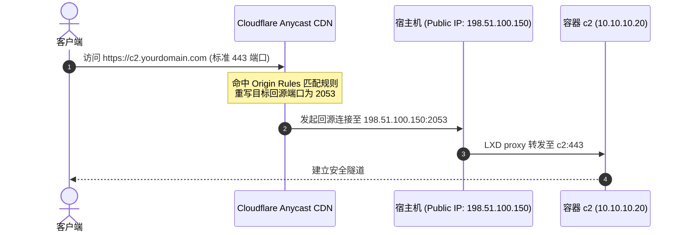
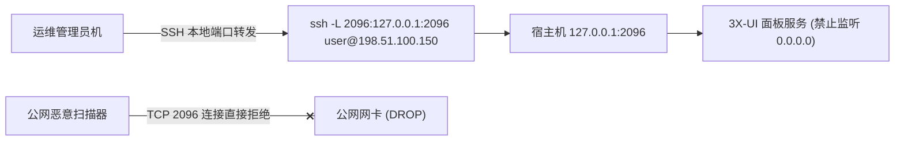

# 4.2 Cloudflare 优选 IP 端口陷阱、Origin Rules 无端口回源与面板纯内网加固

> **深挖 Cloudflare 优选 Clean IP 在非 443 端口上的超时陷阱（PR #10），利用 Cloudflare Origin Rules 实现优雅无端口访问，并彻底封堵 3X-UI 面板的公网暴露面。**

---

## 一、 [重大踩坑复盘] Cloudflare 优选 IP 的非 443 端口超时陷阱（PR #10）

### 1. 现象：为什么优选 IP 节点在部分端口上全军覆没？

在集群多开时，为了解决各容器与协议抢占公网 443 端口的问题，我们将备用节点部署在 Cloudflare 官方支持的备用 HTTPS 端口（如 2053、2083、8443）上。然而在测试客户端连接时发现：
> “使用域名连接一切正常，但只要将节点地址替换为各大测速脚本跑出的**国内优选 Clean IP（如 `162.159.x.x`）**，连接便立刻陷入死寂，TLS 握手无限超时！”



### 2. 根因与规避准则

* **边缘节点端口监听策略差异**：Cloudflare 遍布全球的 Anycast 节点中，大量轻量级边缘节点仅在 `443` 与 `80` 端口上挂载了监听器；备用端口（2053/2083/8443 等）仅在特定主干数据中心才开放承接；
* **优选 IP 库局限**：网络上公开的“移动优选”、“联通优选”IP，绝大多数是针对 443 端口测速优选的；
* **工程规避准则**：
  1. 凡是挂载**优选 IP** 的节点配置，**必须严格且仅绑定 443 端口**；
  2. 位于 2053、2083 等备用端口上的容器节点，客户端必须直接走 CNAME 官方域名解析，由 Cloudflare 权威 DNS 自动调度至全端口开放的主干边缘。

---

## 二、 Cloudflare Origin Rules：告别客户端端口后缀

在容器集群中，容器 c2 映射在宿主机的 `2053` 端口上。如果让用户在客户端输入 `https://c2.yourdomain.com:2053`，体验极差且容易被安全工具标记。

借助 **Cloudflare Origin Rules（回源规则）**，可实现无感重写：



### Cloudflare 控制台配置步骤
1. 进入 Cloudflare 控制台 -> 选择目标域名 -> 点击左侧 **Rules（规则）** -> **Origin Rules（回源规则）**；
2. 点击 **Create rule（创建规则）**：
   * **Rule name**：`Rewrite-c2-port-2053`；
   * **When incoming requests match**：`Hostname equals c2.yourdomain.com`；
   * **Destination port**：选择 **Rewrite to...（重写至）**，输入 `2053`；
3. 保存并部署。客户端此后仅需访问 `c2.yourdomain.com:443` 即可直通容器 c2！

---

## 三、 面板安全防护：从公网暴露到纯内网加固

3X-UI 或各类管理面板如果在公网开放高位端口，极易遭遇字典扫描爆破与零日漏洞入侵。在 `vps-deploy-skill` 的设计哲学中，**面板访问默认采用“纯内网隔离”策略**：



### 1. 建立安全 SSH 隧道访问命令

```bash
# 在本地电脑终端执行（将远端 127.0.0.1:2096 映射到本机 127.0.0.1:2096）
ssh -N -L 2096:127.0.0.1:2096 -p 2222 root@198.51.100.150
```
执行后，在本地电脑浏览器直接打开 `http://127.0.0.1:2096` 即可安全登录面板，公网绝无端口暴露。

### 2. 封堵所有非白名单公网探测

配合 Linux UFW 或 iptables，将所有未计划的端口直接置为 `DROP`：

```bash
# 仅放行规划内的 SSH、CDN 端口与 REALITY/Hy2 端口
sudo ufw default deny incoming
sudo ufw allow 2222/tcp comment "Host SSH"
sudo ufw allow 2201:2204/tcp comment "LXC SSH Matrix"
sudo ufw allow 443/tcp comment "REALITY and CDN"
sudo ufw allow 38443/udp comment "Hysteria 2"
sudo ufw allow 3389/tcp comment "RDP TCP"
sudo ufw allow 3389/udp comment "RDP UDP"
sudo ufw enable
```

---

## 🔗 参考资料

* **Cloudflare Origin Rules 官方文档**：[Configure Origin Rules](https://developers.cloudflare.com/rules/origin-rules/features/)
* **OpenSSH 端口转发规范**：[SSH Tunneling Explained](https://man7.org/linux/man-pages/man1/ssh.1.html)
