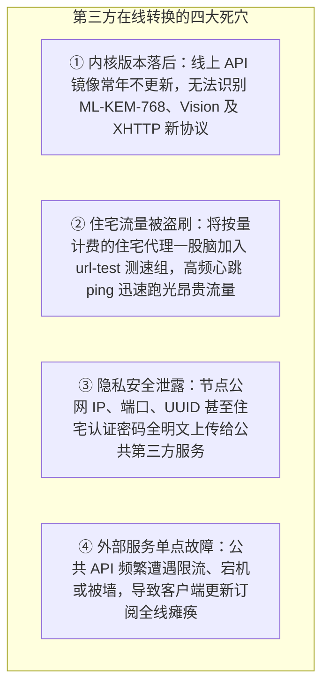

# 5.1 彻底抛弃在线转换：本地原生 Clash YAML 规则引擎与 Split DNS

> **复盘在线订阅转换器的协议不兼容与隐私泄漏痛点，掌握自研本地 Python 商业级 Clash YAML 生成器、Split DNS 防污染及住宅 IP 测速隔离策略。**

---

## 一、 [痛点复盘] 为什么在线订阅转换器屡屡崩溃？

在与 Claude Code 及 AGY 的多轮技术推演中，一个长期困扰用户的问题被推向台前：
> “我把节点链接粘贴到第三方在线订阅转换工具（如 subconverter / onepage）生成 Clash 订阅，导入 Clash Verge Rev 后，要么提示 YAML 语法错误，要么根本看不到 REALITY 或 Hysteria 2 节点；换了几个在线后端依然报错，这究竟是为什么？”



### 根本解法：完全脱离第三方，本地自研 Native 生成器

在 `vps-deploy-skill` 中，开发团队通过 Python 自研了 `clash_generator.py` 与 `merge_clash.py`：
1. **纯本地生成**：在本地内存中直接序列化生成标准 YAML，数据零外泄；
2. **内核深度适配**：直接针对最新 Mihomo / Clash Verge Rev 特性编写，原生支持 `support-x25519mlkem768` 与 Hysteria 2 混淆；
3. **住宅节点严格隔离**：按量计费节点强制独立成组，绝对不纳入自动化测速池。

---

## 二、 客户端 Split DNS 架构（防污染 + 国内低延迟）

传统配置将全部域名统统抛给国外 DNS 解析，不仅导致访问国内网站时被调度至海外 CDN 节点导致极高延迟，还极易受到本地运营商的 DNS 劫持。

本方案在 YAML 中注入严密的 **Split DNS** 配置：

```yaml
dns:
  enable: true
  listen: :1053
  ipv6: false
  enhanced-mode: fake-ip
  fake-ip-range: 198.18.0.1/16
  nameserver:
    - https://1.1.1.1/dns-query
    - https://8.8.8.8/dns-query
  nameserver-policy:
    "geosite:cn":
      - https://doh.pub/dns-query
      - https://dns.alidns.com/dns-query
```

* **大陆域名走本地权威 DoH**：命中 `geosite:cn` 的流量使用腾讯（DNSPod）与阿里公共 DoH 解析，秒开国内网页，精准匹配本地 CDN；
* **海外域名走加密 Fake-IP**：海外流量直接返回 Fake-IP，由远端 VPS 代理节点代为向 1.1.1.1 查询，彻底根除 DNS 污染。

---

## 三、 住宅节点隔离策略（严防流量偷跑）

```yaml
proxy-groups:
  # 1. 自动测速优选组：仅允许不限流量的机房直连节点参与！
  - name: "⚡ 自动优选 (常规机房)"
    type: url-test
    url: http://cp.cloudflare.com/generate_204
    interval: 300
    tolerance: 50
    proxies:
      - "Japan-IIJ-REALITY-Direct"
      - "Japan-SoftBank-Hy2"
      - "US-DMIT-Cloudflare-CDN"

  # 2. 住宅出海专属组：类型必须为 select（手动选择），禁止配置 interval 与 url-test！
  - name: "🏠 跨境住宅落地 (按需启用/防跑流量)"
    type: select
    proxies:
      - "US-Residential-ISP-Static"
      - "UK-Residential-ISP-Rotating"
      - "DIRECT"

  # 3. 总出站分流组
  - name: "🚀 PROXY"
    type: select
    proxies:
      - "⚡ 自动优选 (常规机房)"
      - "🏠 跨境住宅落地 (按需启用/防跑流量)"
      - "Japan-IIJ-REALITY-Direct"
      - "DIRECT"
```

> [!CAUTION]
> 绝不能将按 G 计费的住宅节点加入 `type: url-test`。Clash 的自动测速默认每几分钟下载一次测试包，多设备并发测试可在几天内耗尽数十美元的住宅流量包！

---

## 🔗 参考资料

* **Mihomo (Clash.Meta) 官方配置标准文档**：[Mihomo Configuration Specification](https://wiki.metacubex.one/config/)
* **RFC 8484 (DNS Queries over HTTPS - DoH)**：[RFC 8484 Specification](https://datatracker.ietf.org/doc/html/rfc8484)
