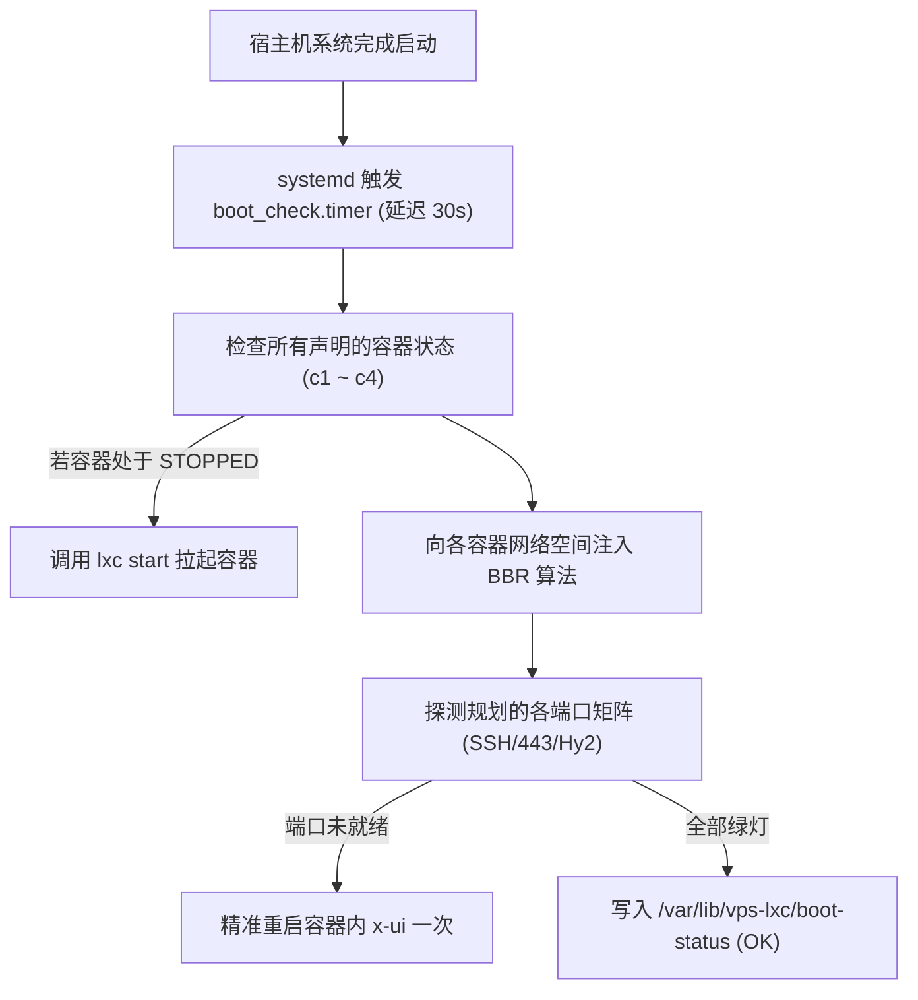

# 5.2 开机自愈检查、容器 BBR 修复与 vnStat 阶梯流控守护

> **基于 systemd 定时器与 vnStat 构建双重可靠性防线，攻克宿主机重启后容器失活与 BBR 失效问题，实现 80%/90%/98% 阶梯流控绝不关停服务的优雅风控。**

---

## 一、 服务端开机自愈检查（`boot_check.py`）

在云端生产环境中，底层宿主机可能随时因机房维护、电力波动或内核升级而发生意外重启。如果缺乏自愈机制，系统往往面临如下次生灾害：
1. **LXD 容器未能正常拉起**，依赖该容器的转发端口全线中断；
2. **容器内部 BBR 丢失**，网络拥塞控制退化回默认的 `cubic`；
3. **3X-UI 或 Nginx 启动早于网卡配置**，导致监听绑定在 `127.0.0.1` 而未能承接外部流量。

### 开机自愈执行链路



### systemd 守护配置

在宿主机部署 `/etc/systemd/system/vps-boot-check.service`：

```ini
[Unit]
Description=VPS Post-Boot Health Check and Auto-Recovery
After=network-online.target lxd.service
Wants=network-online.target

[Service]
Type=oneshot
ExecStart=/usr/bin/python3 /root/02project/20LXC/scripts/boot_check.py
StandardOutput=journal
StandardError=journal

[Install]
WantedBy=multi-user.target
```

配合启动定时器（开机后 30 秒执行一次）：

```ini
[Unit]
Description=Trigger VPS Boot Check 30s after boot

[Timer]
OnBootSec=30s
AccuracySec=1s

[Install]
WantedBy=timers.target
```

---

## 二、 vnStat 阶梯流控守护（`traffic_guard.py`）

海外 VPS 大多拥有固定的月度流量配额（如 1,500 GB / 月）。超出配额后，服务商通常会按照极其昂贵的单价（如 $0.05 / GB）直接从信用卡扣费，或者直接强制挂起 VPS 导致完全失联。

### 阶梯限速风控策略设计

`traffic_guard.py` 绝不采用暴力停机或关停网卡的粗暴手段，而是通过 Linux **Traffic Control（`tc` 令牌桶限速）** 实现无损降速：

| 流量消耗百分比 | 触发动作 | 网络表现与管理可用性 |
| :--- | :--- | :--- |
| **已用 < 80%** | 无任何限制 | 全速跑满（通常为 1Gbps - 2.5Gbps） |
| **达到 80%** | 系统日志报警 | 记录 WARNING 至日志文件，通知管理员关注 |
| **达到 90%** | **限速至 50 Mbit/s** | 限制上行带宽至 50Mbps，遏制大流量下载，但日常网页与业务完全不受阻 |
| **达到 98%** | **限速至 5 Mbit/s** | 极低速防爆仓模式，**SSH 登录依然流畅，保障管理员随时能远程连接修复** |
| **新月账期日** | **自动清除全部限速** | 根据 `--traffic-reset-day` 自动解禁 `tc` 规则，无缝恢复全速 |

```bash
# 查看当前流量守卫状态
cat /var/lib/vps-lxc/traffic-status
```

### Linux TC 动态限速底层脚本原理

```bash
# 当检测到流量达到 90% 时，动态向公网网卡注入 50Mbps 队列规则
tc qdisc del dev eth0 root 2>/dev/null || true
tc qdisc add dev eth0 root handle 1: htb default 10
tc class add dev eth0 parent 1: classid 1:10 htb rate 50mbit ceil 50mbit

# 进入新账期时，一键清除限速队列，恢复全速直通
tc qdisc del dev eth0 root 2>/dev/null || true
```

---

## 🔗 参考资料

* **vnStat 网络流量监控守护进程**：[vnStat GitHub Repository](https://github.com/vergoh/vnstat)
* **Linux Traffic Control (TC) 官方手册**：[tc(8) Linux Manual Page](https://man7.org/linux/man-pages/man8/tc.8.html)
* **systemd.timer 定时器官方文档**：[systemd.timer Documentation](https://www.freedesktop.org/software/systemd/man/latest/systemd.timer.html)
