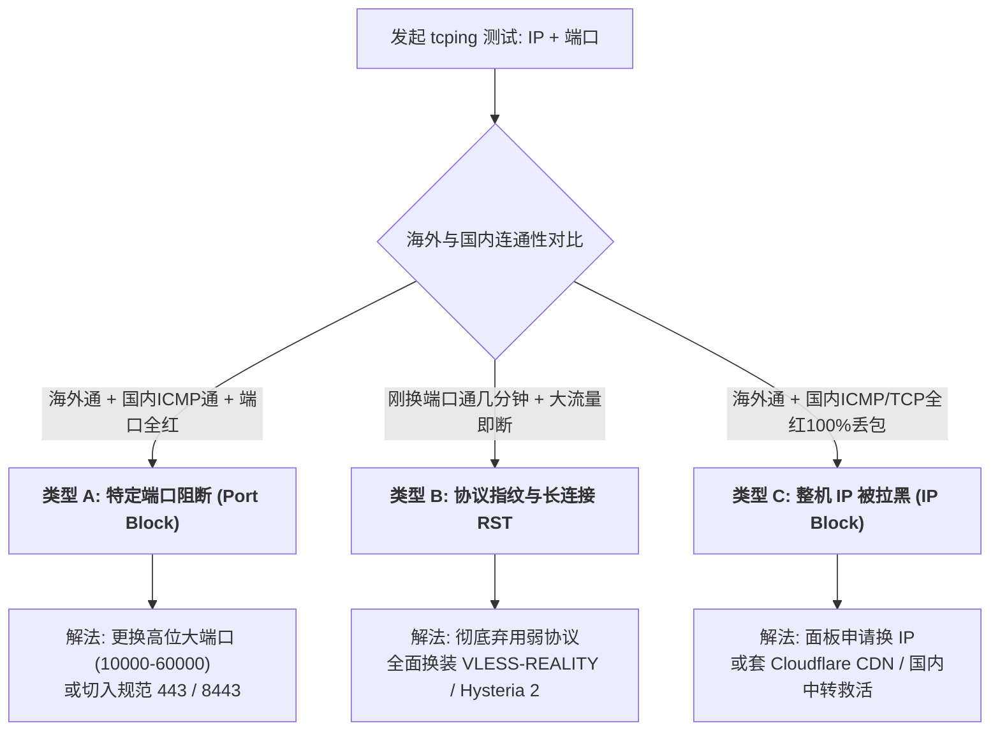

# 5.3 跨境网络故障初判金字塔：客户报错自省、VPS 厂商故障、GFW 阻断三型与中转住宅 400ms 延迟真相

> **核心目标**：构建生产级出海与代理网络故障分级初判矩阵（Triage SOP）。当客户或团队反馈“VLESS 网络 Error”、“节点死活连不上”或“延迟高达 400ms 大卡顿”时，严禁无脑重装系统或盲目更换服务器；必须按照“客户端自省 $\to$ VPS 厂商控制面 $\to$ GFW 阻断分型 $\to$ 物理多跳延迟真相 $\to$ 低配硬件与链路自愈”五级金字塔进行精准溯源与分钟级救活。

---

## 一、 为什么必须建立“故障初判金字塔”？

在运维海外 VPS、节点集群或跨国加速服务时，最常见的客户工单莫过于一句话：
> “节点一直很稳定，今天突然连不上了，客户端报网络 Error，是不是你们节点挂了/被墙了？”

许多初级运维遇到该报错，往往会陷入以下三大误区：
1. **直接登录后台重启服务器或重装系统**：完全不看日志，重装后发现端口仍然不通，甚至破坏了原有的环境配置；
2. **盲目找云厂商客服撕扯或花钱申请换 IP**：甚至没查明到底是母机故障、账单欠费，还是本地 Wi-Fi 丢包；
3. **被“400ms 延迟”带偏**：误以为优化中转加住宅落地必须做到几十毫秒，为了降延迟去乱改全局路由，反而导致国内大厂 App 疯狂异地风控。

为了实现工业级排障，我们定义如下 **网络故障排查五级金字塔模型**：

```{mermaid}
flowchart TD
    Tier1["<b>Tier 1: 客户端环境自省与隔离</b><br/>(关Wi-Fi换手机5G / 换终端设备 / 检查系统时间与规则)"]
    Tier2["<b>Tier 2: VPS 厂商控制面与物理硬件核验</b><br/>(面板实例状态 / 母机欠费与DDoS公告 / VNC终端排障)"]
    Tier3["<b>Tier 3: GFW 阻断精准分型与全网多维探测</b><br/>(端口封锁 vs 协议指纹RST vs IP全黑 / tcp.ping.pe / itdog)"]
    Tier4["<b>Tier 4: 跨洋多跳与住宅落地延迟解构</b><br/>(中转+住宅400ms物理必然 / 全局测速灾难 / ip.net.coffee)"]
    Tier5["<b>Tier 5: 极低配硬件与内核链路瓶颈自愈</b><br/>(128M/256M OOM / Swap扩容 / Go内存锁死 / 网卡Drop)"]

    Tier1 --> Tier2
    Tier2 --> Tier3
    Tier3 --> Tier4
    Tier4 --> Tier5
```

---

## 二、 Tier 1：客户端本地环境自省排查（Client Self-Diagnosis SOP）

当客户端报错 `Network Error`、`Connection Refused` 或握手超时时，**第一优先级是排除客户端自身环境，切忌一上来就改动服务端**！

### 1. 关 Wi-Fi，换移动蜂窝流量（4G/5G）测试
* **排查逻辑**：国内家庭宽带或企业内网环境极其复杂，部分地区运营商（如长宽、广电、部分移动省网）会在光猫或局域网出口强制部署透明 DNS 代理，或针对常见高位端口实施局域网丢包。
* **SOP 指引**：让用户立即关闭手机 Wi-Fi，断开路由器，直接开启手机数据流量连接节点。若蜂窝网络秒连，则 100% 为本地路由器拦截、内网防火墙阻断或光猫 DNS 劫持。

### 2. 交叉换机测试（手机 vs 电脑 vs 平板）
* **排查逻辑**：排除单个操作系统的本地驱动与证书故障。
  * **TUN 虚拟网卡死锁**：Windows / macOS 客户端（如 Clash Verge Rev、v2rayN）如果异常退出，经常残留旧的虚拟网卡或代理环境变量未清除。
  * **系统时间严重偏移（致命避坑点）**：VLESS、VMess 与 REALITY 协议深度依赖时间戳校验。若客户端电脑主板电池没电或未开启 NTP 同步，**本地时间与国际标准时间（UTC）误差只要超过 90 秒，TLS 握手协议会直接判定为重放攻击而拒绝连接**！
* **CLI 自检命令（Windows / Linux）**：
  ```bash
  # Linux 检查时间同步状态
  timedatectl status
  # 强制同步网络时间
  chronyc -a makestep || ntpdate -u pool.ntp.org
  ```

### 3. 分流规则与订阅损坏核验
* 检查客户端是否将目标域名误加入到了 `REJECT` 黑名单组；
* 检查客户端本地存储空间是否爆满导致配置写入失败。

---

## 三、 Tier 2：VPS 厂商控制面与物理硬件核验（Provider & Hardware Triage）

若所有设备均无法连接，下一步应核验云厂商基础设施与母机状态。

### 1. 登录厂商控制台与实例状态检查
* **检查实例生命周期**：登录厂商后台（如 SolusVM、Virtualizor、Proxmox、AWS、RackNerd 控制面板），核验机器是否为 `RUNNING` 状态。
* **检查欠费与滥用封停（Abuse / Suspension）**：
  * 是否因信用卡过期导致账单超期被系统自动暂停（`SUSPENDED`）；
  * 是否因节点内产生对外扫描、垃圾邮件端口（25端口）爆破被机房自动隔离上锁。

### 2. 机房公告与母机 DDoS 清洗（Blackhole / Null-routing）
* 查看厂商官网 Status 状态页面（如机房光纤割接、母机电力维护）；
* **DDoS 牵引与空路由**：同母机邻居若遭遇数百 Gbps 的大流量攻击，机房上游网络为了保全交换机，会将整台母机或受害 IP 牵引至黑洞（Null-route），通常持续 15 分钟至 2 小时，期间所有公网流量均无法到达该 IP。

### 3. 救命稻草：厂商网页版 VNC 终端直连排障
当公网 SSH 彻底失去响应时，**绝不要立刻断定 IP 被封**，应立刻通过厂商后台提供的 **noVNC 终端（HTML5 VNC Console）** 直连母机：
* **排查 Kernel Panic 与宿主机宕机**：若控制台全黑无响应，直接触发面板后台的 `Force Reboot`（硬重启）；
* **检查网卡 IP 与路由表**：
  ```bash
  # 检查主网卡是否正常获取到 IPv4 地址
  ip -4 addr show
  # 检查默认网关是否可达
  ip route show
  ping -c 2 1.1.1.1
  ```
* **检查服务端核心进程存活**：
  ```bash
  # 检查代理核心进程是否崩溃（如 x-ui / xray / sing-box）
  systemctl status x-ui || systemctl status xray
  # 检查监听端口是否真实打开
  ss -tulpn | grep -E "xray|x-ui|sing-box"
  ```

---

## 四、 Tier 3：GFW 阻断精准分型与全网多维探测矩阵

如果母机运行正常、服务端口处于 LISTEN 状态，但国内依然无法访问，则进入 GFW 阻断排查。必须学会用自动化工具判断**究竟是哪种维度的被墙**，因为不同类型的解法完全不同！

### 1. 常用探测平台与批量验证工具库

| 工具名称 | 探测维度 | 官方网址与功能定位 |
| :--- | :--- | :--- |
| **TCP Ping.pe** | 全球 vs 国内分省 TCPing | [https://tcp.ping.pe](https://tcp.ping.pe)（对比全球 30+ 节点与国内 10+ 节点对指定端口的 SYN 回包率） |
| **ITDog TCPing** | 全国三大运营商多省节点 | [https://www.itdog.cn/tcping/](https://www.itdog.cn/tcping/)（秒级测试电信、联通、移动对特定端口的连通率与时延） |
| **IP Net Coffee** | 跨国链路与延迟多径分析 | [https://ip.net.coffee/link/](https://ip.net.coffee/link/)（精准评估跨洲海底光缆跳步与丢包） |
| **NextTrace CLI** | 路由回程与骨干网追踪 | `curl -sL nxt.to | bash`（可视化定位路由在哪个省份或边界出口被丢弃） |

### 2. GFW 阻断三大精准形态剖析与对症解法



#### 形态 A：特定端口阻断（Port Blocking）
* **特征表现**：
  * 使用 `tcp.ping.pe` 测试，海外所有节点全部全绿；
  * 国内 ICMP（Ping）测试通畅无丢包；
  * 但国内三大运营商向该特定端口（如 `48335`）发送 TCP SYN 报文时，100% 超时无响应。
* **定性**：仅该特定端口被防火墙加入黑名单，服务器 IP 本身是健康的。
* **解决方案**：
  1. 登录服务端（如 3X-UI 面板），将入站监听端口从 `48335` 更改为未被封锁的高位端口（如 `28931`）或标准端口（`443`、`8443`）；
  2. 同步更新客户端配置中的端口字段。

#### 形态 B：DPI 协议指纹与长连接拦截（Protocol Fingerprint / TCP RST）
* **特征表现**：
  * 刚刚更换了一个全新端口，客户端能正常连上几分钟；
  * 一旦发起高码率视频播放或大文件下载，连接突然中断；
  * 客户端日志出现大量的 `read: connection reset by peer`（TCP RST 报文注入）；随后几十分钟内该端口处于被掐断状态。
* **定性**：协议自身存在特征缺陷（如裸 Shadowsocks、明文 VMess、裸 HTTP 代理），被 GFW 深度包检测（DPI）算法动态识别。
* **解决方案**：
  1. **彻底淘汰弱协议**：严禁在公网裸跑未加密或伪装孱弱的协议；
  2. **全面升级抗封锁协议栈**：
     * **首选 VLESS-Reality**：伪装海外大型合规网站（如 `gateway.icloud.com`、`addons.mozilla.org`），消灭 TLS in TLS 嵌套特征；
     * **次选 Hysteria 2 / TUIC**：基于 UDP/QUIC 架构，利用拥塞控制与端口跳跃（Port Hopping）抗丢包与阻断。

#### 形态 C：整机 IP 彻底被封（IP Null-routing / Blacklisted）
* **特征表现**：
  * 海外所有节点 Ping 与 TCPing 全通；
  * 国内所有运营商对该 IP 的 ICMP 与所有端口 TCPing 均为 100% 丢包，完全失联。
* **定性**：IP 已被 GFW 写入全局阻断表。
* **解决方案**：
  1. **厂商控制台换 IP**：许多厂商（如 RackNerd、BandwagonHost、Cloudcone、DigitalOcean）提供付费换 IP（约 2~3 美元）或通过销毁重建实例免费更换 IP；
  2. **Cloudflare CDN / WebSocket 救活**：
     * 配置服务端为 `VLESS-WS` 或 `VMess-WS`，监听 `443` 端口；
     * 将域名解析托管至 Cloudflare 并点亮橙色小云朵（开启代理回源）；
     * 国内客户端连接 Cloudflare 国内优选 Anycast IP，由 Cloudflare 海外节点代理回源至被阻断的 VPS，实现“被封 IP 零成本复活”。
  3. **前置国内合规 NAT VPS 端口转发**：
     * 购买一台廉价国内中转 NAT 机器；
     * 在国内中转机使用 `gost` 或 `iptables` 将流量转发至被封 IP，避开边界路由的公网探测。

---

## 五、 防复发与防被邻居连累机制（Prevention & Defense）

为什么部分极客购买特惠 VPS 后，节点刚部署不到 48 小时就被封？常见深层诱因及防范方案如下：

1. **同 /24 C 段连累效应（Neighbourhood Contamination）**：
   * 在特惠大促机房中，同一 `/24` 掩码网段（例如 `198.51.100.0/24`）如果存在大量无防护裸奔的大流量灰产节点，GFW 会直接对该整段进行“C 段无差别重点布控甚至封锁”。
   * **防御措施**：在部署前，利用 `https://scamalytics.com` 校验该 IP 的欺诈风险分（Fraud Score）；若发现整段早已被污染，果断销毁重建实例更换不同子网段。
2. **避免长连接超大流（Elephant Flow）突发**：
   * 避免一个 TCP 连接持续数小时单向传输上百 GB 流量，易引起骨干网异常流量监测告警。
   * **防御措施**：在客户端配置连接复用（Multiplexing / Mux）削峰，或设置单连接生存周期。

---

## 六、 Tier 4：跨洋多跳与中转住宅 400ms 物理延迟真相

客户经常产生的另一大核心抱怨是：
> “为什么我的节点延迟测出来有 380ms 甚至 450ms？这么高是不是太卡了，是不是节点不行？”

必须用物理常识与网络工程原理解开这个误区！

### 1. 跨太平洋多跳中转的物理定律与时延模型

光在真空中的传播速度为 $300,000\text{ km/s}$，而在海底通信光纤玻璃介质中的光速只有真空中的约三分之二（约为 $200,000\text{ km/s}$）：
* 从中国东部沿海（如上海）到美国西海岸（如洛杉矶/圣何塞），物理光缆距离通常在 $10,000\text{ km}\sim 12,000\text{ km}$ 之间；
* 光信号单程飞行时延（One-Way Delay）最少需要：
  $$\text{单程物理极限} = \frac{10000\text{ km}}{200000\text{ km/s}} \approx 50\text{ ms}$$
* 一个完整的 TCP 三次握手往返时延（RTT, Round Trip Time）绝对物理极限为：
  $$\text{往返极限 (RTT)} \ge 50\text{ ms} \times 2 = 100\text{ ms}$$
加上沿途数十台核心光纤放大器、路由器排队时延与国内骨干网路由跳步，**中美直连最顶级的 CN2 GIA 线路真实 RTT 最低也在 130ms ~ 160ms**。

### 2. “优化中转 + 住宅落地”的真实拓扑与耗时累加

当采用高纯净度的跨境出海架构时，网络链路包含多次转发：

```{mermaid}
sequenceDiagram
    autonumber
    actor Client as 国内客户端
    participant Relay as 日本/香港中转优化VPS
    participant ResExit as 美国双ISP静态住宅代理
    participant Target as 美国本土目标 (OpenAI/Stripe)

    Client->>Relay: 1. 国内到日本中转优化出口 (RTT: 35ms ~ 45ms)
    Relay->>ResExit: 2. 日本到美国住宅节点跨洋跳步 (RTT: 140ms ~ 160ms)
    ResExit->>Target: 3. 美国住宅内网访问本土机房 (RTT: 15ms ~ 25ms)
    Target-->>ResExit: 4. 本地回包
    ResExit-->>Relay: 5. 跨洋回传中转
    Relay-->>Client: 6. 极速回传国内终端
```

在上述链路中：
1. **跳步 1**：客户端 $\to$ 优化中转（如上海 $\to$ 日本大阪）：耗时 $\approx 40\text{ms}$；
2. **跳步 2**：中转 VPS $\to$ 美国住宅代理节点（跨太平洋光缆）：耗时 $\approx 150\text{ms}$；
3. **跳步 3**：中转协议拆包与住宅 SOCKS5/HTTP 隧道二次封装握手：耗时 $\approx 80\text{ms}$；
4. **跳步 4**：住宅宽带接入网到运营商机房（Last-mile Cable/DSL Jitter）：耗时 $\approx 40\text{ms}$；
5. **跳步 5**：TLS 端到端安全加密重协商：耗时 $\approx 50\text{ms}$。

$$\text{总端到端延迟} = 40 + 150 + 80 + 40 + 50 = \mathbf{360\text{ ms} \sim 450\text{ ms}}$$

> [!NOTE] 核心认知
> **中转 + 住宅落地节点的整体延迟在 350ms ~ 450ms 之间，是 100% 完全符合物理定律与代理开销的健康表现！** 住宅代理的核心价值在于 **双 ISP 原生纯净住宅 IP、零风控、防封号**，绝非追求低延迟打游戏。

### 3. 重大排错避坑：客户开启“全局代理（Global Mode）”测速的灾难

客户觉得“延迟高、卡顿”的最常见人为原因，是**错误地开启了全局代理并访问国内网站**！

* **灾难现象**：客户将客户端设为 `GLOBAL`，打开百度测速或运行国内测速脚本；
* **荒诞链路**：
  $$\text{国内手机} \longrightarrow \text{日本中转} \longrightarrow \text{美国住宅落地} \longrightarrow \text{跨洋回国访问国内百度} \longrightarrow \text{原路返回美国住宅} \longrightarrow \text{日本} \longrightarrow \text{国内}$$
  流量相当于**绕地球飞了一圈半，物理往返里程超过 40,000 公里，延迟瞬时冲破 800ms+**，网页必定大面积卡死！
* **标准验收准则**：
  1. 必须配置并强制启用 **Split DNS 与规则分流**（国内域名直连，海外流量走代理）；
  2. 衡量住宅代理好坏的唯一标准，是**从美国住宅节点访问美国本土服务（如 OpenAI API、Stripe、Claude、Google）的延迟与吞吐**，该段延迟通常只有 $10\text{ms}\sim 25\text{ms}$，响应极度丝滑！
  3. 推荐使用 [https://ip.net.coffee/link/](https://ip.net.coffee/link/) 专门评测海外段链路。

---

## 七、 Tier 5：极低配硬件与内核链路瓶颈自愈（128MB/256MB VPS）

部分开发者使用低价小内存 VPS（如 128MB / 256MB RAM）部署节点，经常出现“连上几小时后突然断开，重启又好了”的诡异故障，这是典型的硬件资源枯竭。

### 1. Linux OOM Killer 杀进程排查
当代理核心（Xray、V2Ray、Sing-box）并发连接过多或遭遇内存碎片泄漏时，Linux 内核会触发 `OOM Killer` 自动杀死内存占用最高的进程。

```bash
# 检查内核日志中是否触发了 OOM 杀进程
dmesg -T | grep -E -i "killed process|out of memory|oom"
# 查看历史日志
journalctl -xe | grep -i oom
```

### 2. 极简一键救急：挂载 1GB ~ 2GB Swap 虚拟内存
小内存机器必须挂载 Swap，否则绝无稳定性可言：

```bash
# 1. 创建 1GB 的 swap 镜像文件
fallocate -l 1G /swapfile || dd if=/dev/zero of=/swapfile bs=1M count=1024

# 2. 设置安全权限（严禁其他用户读取）
chmod 600 /swapfile

# 3. 格式化并激活 swap
mkswap /swapfile
swapon /swapfile

# 4. 写入 fstab 实现开机自启
echo '/swapfile none swap sw 0 0' >> /etc/fstab

# 5. 调整 swappiness 保持性能（仅在物理内存剩余 10% 时使用 swap）
sysctl vm.swappiness=10
echo 'vm.swappiness=10' >> /etc/sysctl.conf
```

### 3. Go 语言内存限制锁死（`GOMEMLIMIT`）
现代代理工具普遍由 Go 语言编写。在 256MB 机器上，可通过环境变量锁定 Go 运行时的 GC 激进触发阈值，严防内存突发打满：

```bash
# 在 systemd 服务单元文件（如 /etc/systemd/system/x-ui.service）的 [Service] 段添加：
Environment="GOMEMLIMIT=180MiB"
Environment="GOGC=50"
```

### 4. 物理母机网线、软路由网卡 Drop 故障自检
如果服务器或家庭软路由出现无规律丢包：

```bash
# 查看网络接口丢包、错包、溢出计数
ip -s link show eth0
```
若发现 `RX errors` 或 `dropped` 持续上升：
* **VPS 环境**：说明母机物理网卡超售或虚拟网卡驱动（virtio_net）存在 Bug，需工单联系服务商迁移母机；
* **本地软路由环境**：100% 为网线水晶头老化、接触不良或软路由缺少网卡固件加速。

---

## 八、 跨境网络故障排查 5 分钟速查矩阵（SOP Cheat Sheet）

| 故障现象 | 根因定性 | 推荐排障命令 / 探测网站 | 终极解决方案 |
| :--- | :--- | :--- | :--- |
| **仅自己手机打不开，换 5G 流量秒通** | 本地 Wi-Fi 路由器拦截 / 内网 DNS 劫持 | 关闭 Wi-Fi 隔离测试 | 检查本地路由器分流；光猫改桥接；客户端指定公共 DoH |
| **手机与电脑时间差 2 分钟，提示认证失败** | VLESS / Reality 时间戳鉴权拦截 | `timedatectl status` | 开启 NTP 网络时间同步；校准主板 BIOS 电池 |
| **服务状态为 RUNNING，但 SSH / 端口全断** | 母机宕机 / 宿主机欠费 / DDoS 黑洞 | 厂商控制台后台 noVNC 网页直连 | 登录 VNC 救活；排查网卡配置；硬重启实例 |
| **海外全通，国内 Ping 通，但代理端口全红** | GFW 封锁特定高位端口（形态 A） | [https://tcp.ping.pe](https://tcp.ping.pe) | 3X-UI 面板将端口更换至未被封锁端口（如 443/8443） |
| **换端口能通 2 分钟，大流量立即断开报 RST** | DPI 识别弱协议指纹拦截（形态 B） | 检查客户端日志 `connection reset` | 彻底弃用弱协议，全面升级为 **VLESS-Reality / Hysteria 2** |
| **海外通畅，国内所有省份 Ping 100% 丢包** | 整个 IP 被 GFW 全局拉黑（形态 C） | [https://www.itdog.cn/tcping/](https://www.itdog.cn/tcping/) | 面板申请更换 IP；或套 Cloudflare CDN 443 回源救活 |
| **中转+住宅落地测试延迟 380ms 嫌太慢** | 跨洋光纤与住宅二次转发正常物理耗时 | [https://ip.net.coffee/link/](https://ip.net.coffee/link/) | 纠正错误认知；严防全局测速；验证美国本土目标延迟 |
| **开了代理后闲鱼、抖音、国内网银大卡顿** | 客户端误开全局代理（Global Mode） | 检查分流规则与 DNS 调度 | 严格切换为 **Rule（规则）分流** 与 **Split DNS** |
| **VPS 运行数小时后代理进程无故神秘消失** | 128MB/256MB 内存耗尽触发 OOM Killer | `dmesg -T \| grep -i oom` | 创建 1GB Swap 文件；添加 `GOMEMLIMIT=180MiB` |
| **白天飞快但晚高峰 Hysteria 2 报 -1 / 断流** | 国际出口（CMI）跨洋 UDP 严重 QoS 丢包 | `tcpdump -i any udp port <P> -nn -v` | 切换 **Cloudflare CDN 443** 边缘终结，或采用 **日本高速直连中继 + Realm 转发** |
| **客户端导入节点全网报 -1 / 订阅转换报错** | VLESS URI 携带非标后量子参数或版本拦截 | 检查 URI 是否含 `support-x25519mlkem768` | 剥离非标参数，回归通用 X25519；3X-UI 入站清空 `minClientVer: ""` |
