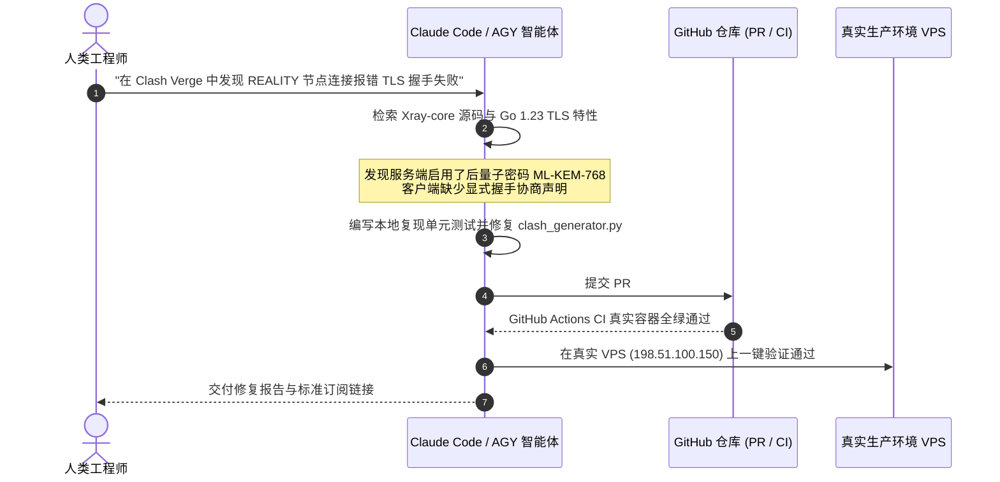

# 6.1 跨大模型通用 AI Skill 架构设计与智能体协同研发实录

> **解构全兼容 OpenAI、Claude、Gemini/AGY 的标准化 AI Skill 规范，复盘人类工程师与智能体（Claude Code / AGY）在复杂网络工程中的协同研发范式。**

---

## 一、 什么是现代 AI Skill？标准目录契约解析

在传统认知中，运维脚本通常是一堆离散的 Shell 或 Python 文件。而在大模型时代，**AI Skill 是包含“结构化意图定义、上下文提示词约束、自动化测试套件与执行脚本”的自包含模块**。

本项目沉淀的 Skill 标准目录架构如下：

```text
vps-deploy-skill / vps-lxc-skill
├── SKILL.md                 # 核心元数据契约（大模型理解该技能何时被唤起的首要信源）
├── claude/                  # Anthropic Claude 格式的 System Prompt 与上下文增强
├── gemini/                  # Google Gemini / Antigravity (AGY) 专属发现协议
├── openai/                  # OpenAI GPTs / Actions 专用的 JSON Schema
├── i18n/                    # 中英文国际化描述（README_zh.md / SKILL_zh.md）
├── scripts/                 # 核心 Python 执行引擎（参数严格强类型校验、无副作用重试）
├── tests/                   # 自动化单元测试与端到端测试
└── .github/workflows/       # 真实容器环境 CI 门禁
```

### `SKILL.md` 核心定义规范

`SKILL.md` 包含标准的 YAML Frontmatter，告知智能体在何时、以何种参数唤醒该能力：

```yaml
---
name: vps-lxc-skill
description: "Automated LXC Container Provisioning Engine for Linux VPS Instances. Deploys 1-6 isolated containers with Cloudflare CDN port matrix, native RDP 3389 direct connection, and 3X-UI/Docker nesting support."
version: 1.0.0
---

## When to use this skill
When the user asks to split a Linux VPS into lightweight isolated containers, wants to run multiple independent proxy instances, or needs an isolated remote desktop environment on a single machine.
```

---

## 二、 人机协同研发历程：从对话问题到代码与 PR 演进

回顾整个工程演进，所有关键架构迭代均诞生于**“人类提出真实痛点 -> 智能体深度检索分析 -> 编写测试复现 -> 提交 PR 并通过 CI -> 部署上线”**的闭环过程：



### 典型 PR 演进树
* **PR #3 & #5**：解决 LXD 4.0/5.21 兼容性、Profile 隔离与已占用端口在 `ss` 中漏检的问题；
* **PR #8**：全栈 CI 门禁建立，引入 3X-UI SQLite 数据库单事务原子保护；
* **PR #10**：修复 Cloudflare 优选 Clean IP 在非 443 端口上的超时失活死局；
* **PR #11**：引入 Split DNS 分流与 XHTTP 传输流控；
* **PR #14**：攻克后量子 ML-KEM-768 握手、`exit_all` 封死 QUIC 泄漏防封。

---

## 三、 自然语言驱动的极简生产运维体验

在 Skill 封装完毕后，无论是管理员在终端，还是智能体在自动化流中，都可以用高度语义化的自然语言调度底层复杂的基础设施：

```text
Prompt 示例：
"请帮我调用 vps-lxc-skill，在这台日本 VPS（IP: 198.51.100.150，SSH 端口: 2222）上
划分 4 个容器，开启 auto-split 内存分配，容器 c4 映射 3389 远程桌面，
并配置每月 1500GB 的流量守卫。"
```

智能体在接收到上述指令后，将自动调用 Python 引擎：
1. 先行执行 `--check-host` 预检主机内核与 BBR 支持；
2. 校验规划的 14 个公私网端口无冲突；
3. 一键完成静默部署并生成标准交付报告，全程耗时不超过 90 秒。

---

## 🔗 参考资料

* **Anthropic Model Context Protocol (MCP) 与 Skill 设计指南**：[Anthropic MCP Documentation](https://modelcontextprotocol.io/)
* **Google Antigravity 自定义技能开发白皮书**：[Antigravity CLI Customizations](file:///root/.gemini/antigravity-cli/builtin/skills/agy-customizations/SKILL.md)
