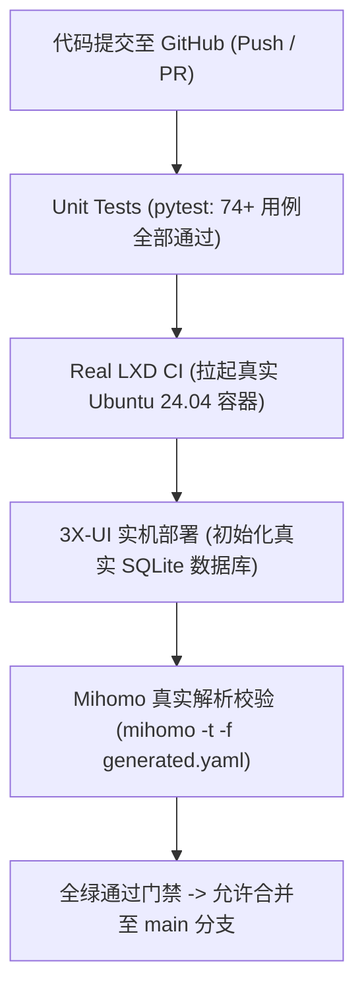

# 6.2 真实 LXD 与 Mihomo CI 质量门禁、故障排查手册与生产运维 SOP

> **构建基于真实容器与客户端内核的自动化 CI 质量门禁，建立包含预检、部署、灾备回滚与网络排错的工业级生产运维 SOP。**

---

## 一、 为什么自动化运维必须引入“真实容器与内核 CI 门禁”？

在许多开源项目中，测试往往停留在“Mock 模拟测试”（单元测试断言 mock 命令的返回参数）。这种测试在真实生产环境中极易失效：
* **Mock 无法发现内核级网络丢包**：无法探测 iptables 规则冲突、Docker 与 LXD 的 `FORWARD DROP` 碰撞；
* **Mock 无法捕捉客户端解析器的语法限制**：只有真正的 Mihomo 二进制文件，才能验证生成的 YAML 配置文件中是否存在 Group 环形依赖（DAG 破坏）或后量子密码不兼容。

### GitHub Actions 全栈 CI 矩阵设计



在 GitHub Actions 中，测试流水线会实际执行：
```bash
# 验证生成的 Clash 配置是否能被真正的 Mihomo 客户端内核无警告加载
./bin/mihomo -t -f ./output/clash_config.yaml
```
只有当返回 `configuration file test is successful` 时，PR 才能获准合并。

---

## 二、 生产级全流程部署与运维 SOP

### 1. 阶段一：宿主机健康预检（零破坏）

在对任何生产 VPS 执行变更前，必须运行无损预检命令：

```bash
# 检查宿主机操作系统、内核 BBR、内存与磁盘承载力
python3 /root/02project/20LXC/scripts/vps_lxc.py \
    --ip 198.51.100.150 \
    --ssh-port 2222 \
    --count 4 \
    --check-host
```
* **输出 `OK`**：宿主机完全符合生产标准，允许执行后续部署；
* **输出 `WARN`**：存在次要告警（如非首选发行版），需记录但允许运行；
* **输出 `FAIL`**：存在致命红线（如属于 OpenVZ 架构或无 BBR），**程序强制熔断，严禁继续**。

### 2. 阶段二：一键容器化集群交付

```bash
# 部署 4 容器黄金拓扑，绑定 1500GB 月度流量守卫
python3 /root/02project/20LXC/scripts/vps_lxc.py \
    --ip 198.51.100.150 \
    --ssh-port 2222 \
    --count 4 \
    --auto-split \
    --traffic-limit-gb 1500 \
    --install-boot-check
```

### 3. 阶段三：单端口 443 自建伪装与全协议部署

```bash
# 在容器 c1 内部部署单端口 443 伪装站点与节点
python3 /root/02project/17_vps_skill/scripts/vps_deployer.py \
    --ip 198.51.100.150 \
    --ssh-port 2201 \
    --profile reality-self \
    --domain node.yourdomain.com
```

---

## 三、 高频故障排查与速查诊断手册（Troubleshooting Matrix）

| 故障现象与报错 | 核心根因判断 | 标准处理与恢复命令 |
| :--- | :--- | :--- |
| **`Error: Port 24433 already in use`** | 宿主机已有容器 NAT 设备占用了该端口 | 运行 `lxc config device show <container>` 排查并释放冲突设备 |
| **`handshake failure: remote error`** | 客户端未配置后量子密码或内核版本过低 | 节点链接追加 `support-x25519mlkem768=true`，升级 Mihomo 至 >= 1.8.0 |
| **`容器内部拥塞控制回退为 cubic`** | 宿主机重启后容器未主动继承 BBR | 运行开机自检：`python3 /root/02project/20LXC/scripts/boot_check.py` |
| **`Cloudflare 优选 IP 节点超时`** | 优选 IP 仅开放 443 端口，节点配置了备用端口 | 将优选 IP 绑定在 443 节点上，或改走域名标准回源 |
| **`流量突然受限至 50Mbps`** | 触发了 90% 流量警戒线，激活了 `traffic_guard` | 检查状态：`cat /var/lib/vps-lxc/traffic-status`，若确属误报可临时执行 `tc qdisc del dev eth0 root` |

---

## 四、 自动化全节点流量验收与核心生产指令集

在 `vps-skill` 与 `20LXC` 工程实践中，沉淀了一套极具杀伤力的**“一键真实流量验收”与“零停机热升级”脚本体系**，杜绝上线后“客户端连不上、流量不扣费、进程静默死掉”等隐蔽故障。

### 1. 端到端全节点流量真实验收脚本（`check_clients.py`）

不要只依赖 ping 延迟或 TCP 端口连通。`check_clients.py` 会逐个将生成的 Clash YAML 中的节点提取为独立的临时配置，启动单进程 `mihomo` 客户端监听本地独立端口，并通过 `curl -x` 强行向 Cloudflare CDN 拉取 5MB 真实负载文件，核验 HTTP 200 返回码：

```python
#!/usr/bin/env python3
"""
单节点端到端真实流量压测验收引擎
用法: python3 check_clients.py clash_config.yaml [server-ip]
"""
import os, sys, time, tempfile, shutil, signal, subprocess, yaml

TARGET = "https://speed.cloudflare.com/__down?bytes=5000000"
MIHOMO = os.environ.get("MIHOMO", "mihomo")

def test_proxy(proxy: dict, local_port: int) -> str:
    work_dir = tempfile.mkdtemp()
    cfg = {
        "mixed-port": local_port,
        "mode": "global",
        "log-level": "error",
        "ipv6": False,
        "proxies": [proxy],
        "proxy-groups": [{"name": "GLOBAL", "type": "select", "proxies": [proxy["name"]]}],
        "rules": ["MATCH,GLOBAL"]
    }
    cfg_file = os.path.join(work_dir, "test.yaml")
    with open(cfg_file, "w", encoding="utf-8") as f:
        yaml.safe_dump(cfg, f)
    
    # 后台拉起独立客户端进程
    proc = subprocess.Popen([MIHOMO, "-d", work_dir, "-f", cfg_file],
                            stdout=subprocess.DEVNULL, stderr=subprocess.DEVNULL)
    try:
        time.sleep(2)
        code = "000"
        for _ in range(3):
            res = subprocess.run([
                "curl", "-s", "-o", "/dev/null", "-w", "%{http_code}",
                "--max-time", "30", "-x", f"http://127.0.0.1:{local_port}", TARGET
            ], capture_output=True, text=True)
            code = res.stdout.strip()
            if code == "200":
                break
            time.sleep(2)
        return code
    finally:
        proc.send_signal(signal.SIGTERM)
        proc.wait()
        shutil.rmtree(work_dir, ignore_errors=True)

if __name__ == "__main__":
    with open(sys.argv[1], encoding="utf-8") as f:
        proxies = yaml.safe_load(f)["proxies"]
    
    failed = []
    for idx, proxy in enumerate(proxies):
        code = test_proxy(proxy, 17890 + idx)
        status = "✅ PASS" if code == "200" else "❌ FAIL"
        print(f"[{status}] {proxy['name']:<25} 协议: {proxy['type']:<10} HTTP {code}")
        if code != "200":
            failed.append(proxy["name"])
    
    if failed:
        sys.exit(f"⚠️ 验收失败，以下节点未能跑通真实 5MB 流量: {', '.join(failed)}")
    print("🎉 所有节点全量真实流量验收通过！")
```

### 2. 生产服务端无损热升级与校验一键指令

#### ① Xray-core 二进制安全替换 SOP（防配置语法不兼容）
直接覆盖 Xray 二进制有导致面板全线瘫痪的风险。安全升级标准动作：
```bash
# 1. 预检新二进制版本是否能正常加载当前生产配置
cd /usr/local/x-ui/bin
XRAY_LOCATION_ASSET=/usr/local/x-ui/bin /root/xray-new run -test -c config.json

# 2. 只有当返回 "Configuration OK" 时，才执行热替换与面板重启
cp /root/xray-new /usr/local/x-ui/bin/xray-linux-amd64
systemctl restart x-ui
```

#### ② SQLite 生产流量计数器实时查验
验证用户流量是否被 Xray 核心正确捕获并计费：
```bash
sqlite3 /etc/x-ui/x-ui.db "SELECT email, round(down/1024/1024, 2) AS down_MB, round(up/1024/1024, 2) AS up_MB FROM client_traffics WHERE email LIKE 'vps-skill-%';"
```

#### ③ LXC 容器资源限制与优先级免重启动态下发
当某容器进行大流量压测或跑桌面导致 CPU 升高时，无需重启容器，直接在线压制其权重：
```bash
# 将代理核心容器 c1 的 CPU 优先级提升至最高权重 8，内存上限 1024MB
lxc config set c1 limits.cpu.priority 8
lxc config set c1 limits.memory 1024MB

# 将低优先级容器 c4（如桌面/测试容器）权重压制至 3
lxc config set c4 limits.cpu.priority 3

# 即时查验变更结果
lxc config show c1 | grep limits
```

---

## 🔗 参考资料与官方发布源

| 核心组件 | 推荐稳定版 | 官方发布源与文档 | 升级与维护要点 |
| :--- | :--- | :--- | :--- |
| **3X-UI** | `v3.11.0` | [MHSanaei/3x-ui Releases](https://github.com/MHSanaei/3x-ui/releases) | 通过 `--xui-version v3.11.0 --reinstall-xui` 平滑升级 |
| **Xray-core** | `26.10.x` | [XTLS/Xray-core Releases](https://github.com/XTLS/Xray-core/releases) | 必须执行 `xray run -test -c config.json` 预检后方可覆盖 |
| **LXD** | `5.21.x LTS` | [Snapcraft LXD](https://snapcraft.io/lxd) | 保持 LTS 通道 `snap refresh lxd --channel=5.21/stable`，避免盲目升 6.x |
| **Realm** | `2.9.6` | [zhboner/realm Releases](https://github.com/zhboner/realm/releases) | 高性能中转引擎，直接替换单二进制文件并 `systemctl restart realm` |
| **Mihomo Core** | `>= 1.19.9` | [MetaCubeX/mihomo Releases](https://github.com/MetaCubeX/mihomo/releases) | 必须开启 `support-x25519mlkem768: true` 方可与 Xray REALITY 握手 |
| **Clash Verge Rev** | `>= 2.5.8` | [clash-verge-rev Releases](https://github.com/clash-verge-rev/clash-verge-rev/releases) | 跨平台主流 GUI，内置 Mihomo 内核，支持本地原生 YAML 导入 |

