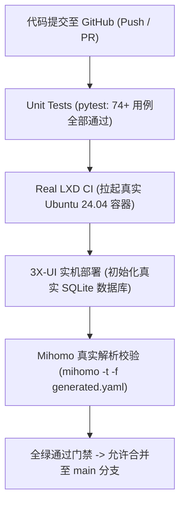

# 6.2 真实 LXD 与 Mihomo CI 质量门禁、故障排查手册与生产运维 SOP

> **构建基于真实容器与客户端内核的自动化 CI 质量门禁，建立包含预检、部署、灾备回滚与网络排错的工业级生产运维 SOP。**

---

## 一、 为什么自动化运维必须引入“真实容器与内核 CI 门禁”？

在许多开源项目中，测试往往停留在“Mock 模拟测试”（单元测试断言 mock 命令的返回参数）。这种测试在真实生产环境中极易失效：
* **Mock 无法发现内核级网络丢包**：无法探测 iptables 规则冲突、Docker 与 LXD 的 `FORWARD DROP` 碰撞；
* **Mock 无法捕捉客户端解析器的语法限制**：只有真正的 Mihomo 二进制文件，才能验证生成的 YAML 配置文件中是否存在 Group 环形依赖（DAG 破坏）或后量子密码不兼容。

### GitHub Actions 全栈 CI 矩阵设计



在 GitHub Actions 中，测试流水线会实际执行：
```bash
# 验证生成的 Clash 配置是否能被真正的 Mihomo 客户端内核无警告加载
./bin/mihomo -t -f ./output/clash_config.yaml
```
只有当返回 `configuration file test is successful` 时，PR 才能获准合并。

---

## 二、 生产级全流程部署与运维 SOP

### 1. 阶段一：宿主机健康预检（零破坏）

在对任何生产 VPS 执行变更前，必须运行无损预检命令：

```bash
# 检查宿主机操作系统、内核 BBR、内存与磁盘承载力
python3 /root/02project/20LXC/scripts/vps_lxc.py \
    --ip 198.51.100.150 \
    --ssh-port 2222 \
    --count 4 \
    --check-host
```
* **输出 `OK`**：宿主机完全符合生产标准，允许执行后续部署；
* **输出 `WARN`**：存在次要告警（如非首选发行版），需记录但允许运行；
* **输出 `FAIL`**：存在致命红线（如属于 OpenVZ 架构或无 BBR），**程序强制熔断，严禁继续**。

### 2. 阶段二：一键容器化集群交付

```bash
# 部署 4 容器黄金拓扑，绑定 1500GB 月度流量守卫
python3 /root/02project/20LXC/scripts/vps_lxc.py \
    --ip 198.51.100.150 \
    --ssh-port 2222 \
    --count 4 \
    --auto-split \
    --traffic-limit-gb 1500 \
    --install-boot-check
```

### 3. 阶段三：单端口 443 自建伪装与全协议部署

```bash
# 在容器 c1 内部部署单端口 443 伪装站点与节点
python3 /root/02project/17_vps_skill/scripts/vps_deployer.py \
    --ip 198.51.100.150 \
    --ssh-port 2201 \
    --profile reality-self \
    --domain node.yourdomain.com
```

---

## 三、 高频故障排查与速查诊断手册（Troubleshooting Matrix）

| 故障现象与报错 | 核心根因判断 | 标准处理与恢复命令 |
| :--- | :--- | :--- |
| **`Error: Port 24433 already in use`** | 宿主机已有容器 NAT 设备占用了该端口 | 运行 `lxc config device show <container>` 排查并释放冲突设备 |
| **`handshake failure: remote error`** | 客户端未配置后量子密码或内核版本过低 | 节点链接追加 `support-x25519mlkem768=true`，升级 Mihomo 至 >= 1.8.0 |
| **`容器内部拥塞控制回退为 cubic`** | 宿主机重启后容器未主动继承 BBR | 运行开机自检：`python3 /root/02project/20LXC/scripts/boot_check.py` |
| **`Cloudflare 优选 IP 节点超时`** | 优选 IP 仅开放 443 端口，节点配置了备用端口 | 将优选 IP 绑定在 443 节点上，或改走域名标准回源 |
| **`流量突然受限至 50Mbps`** | 触发了 90% 流量警戒线，激活了 `traffic_guard` | 检查状态：`cat /var/lib/vps-lxc/traffic-status`，若确属误报可临时执行 `tc qdisc del dev eth0 root` |

---

## 🔗 参考资料

* **Mihomo CLI 命令行与配置校验参数**：[Mihomo Command-Line Interface](https://wiki.metacubex.one/overview/cli/)
* **GitHub Actions 自动化 CI 官方文档**：[GitHub Actions Documentation](https://docs.github.com/en/actions)
