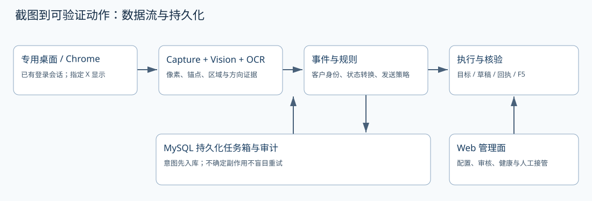

# 闲鱼视觉监控与自动客服工程实战：从 0 到 1

从需求和商业假设出发，在 RK3588 上部署截图＋本地 OCR 系统，完成首次客户邮件、固定关键词、先文字后图片、发送核验及 F5 返回，再讨论多账号管理和跨软件复用。

这是一门基于真实工程过程的复盘与实操课。代码和测量基线冻结在 `f909acb4217231a7839429b532b20a0b4e4441a7`，文档整理日期为 **2026-10-22（America/Los_Angeles）**。运行状态和 issue 可能在此后变化。

## 学完能交付什么

一份商业画布、可解释的技术选型、单账号部署清单、无秘密配置模板、状态机与核心源码阅读记录、可复现基准、受控验收报告、故障恢复 SOP，以及明确标记为设计稿的多账号扩展方案。

|阅读路线|推荐阶段|完成标志|
|---|---|---|
|产品／经营|一、六、八|能解释价值、成本和交付边界|
|第一次部署|一、二、五、六|能启动、暂停、核实结果和恢复|
|核心开发|二、三、四、六|能写回归测试并解释不可逆边界|
|多账号／跨软件|七、八|先设计隔离和权限，再扩大规模|

## 如何理解课程中的证据

**已实现**指冻结源码包含的功能；**案例实测**指指定帧或受控账号上的记录；**已知问题**指该版本尚未修复的边界；**扩展设计**尚需编码和验收。示意命令使用占位 IP、邮箱和凭据。课程不包含真实客户图、原始 HTML、登录目录、口令或令牌。



## 阶段导航

```{toctree}
:maxdepth: 2

stage1_product/index
stage2_architecture/index
stage3_vision/index
stage4_replies/index
stage5_deployment/index
stage6_operations/index
stage7_multi_account/index
stage8_extension/index
appendix/index
```

## 先准备什么

读者需要基本 Python、Linux Shell 和数据库知识；运行实验还需要自己的合法账号、能人工登录的专用桌面和受控接收账号。离线源码阅读不要求连接板子，发送实验必须独立安排并验证接收结果。

本地文档使用 `py310sphinx_knowledge_base`；板上应用使用 `xianyu-monitor`。这是两个环境，不要在文档解释器里安装应用生产依赖。
