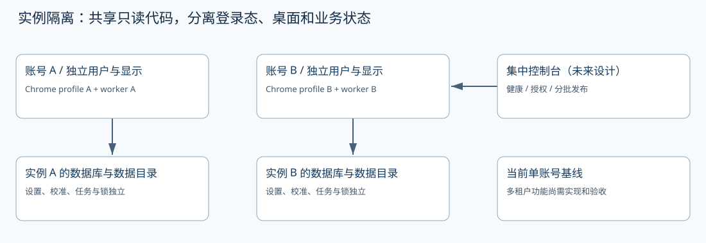

# 14 独立虚拟桌面、Chrome 与共享图片

## 案例中的三个用户角色

`root` 负责服务管理并运行需要 X 权限的应用 worker；`xvm` 运行 Web 后台；`xy-monitor` 拥有独立 XFCE／Xvnc 和 Chrome。Linux 桌面登录、闲鱼网页登录与后台管理员登录是三套身份，不应复用为一个口令。



|资源|案例值|动态核实方式|
|---|---|---|
|X 显示|`:20`|`discover-display`、进程和 X 查询|
|XAUTHORITY|`/home/xy-monitor/.Xauthority`|服务配置与实际权限|
|framebuffer|1280×1440，16 位|`xdpyinfo` 或实际采集尺寸|
|Chrome profile|`/home/xy-monitor/chrome-profile`|检查启动参数|
|专用 RDP|3390|`ss -ltnp` 与私密 RDP 文件|
|原桌面|与专用显示隔离|不要将自动化切回日常桌面|

案例 Chrome 全屏运行、页面 100% 缩放，独立 profile 首次需要用户重新登录。RDP 断开不应结束远端 Xvnc；但显式注销、服务停止或 Chrome 崩溃会影响监控，需单独验证。

## 查看与排障命令

```bash
systemctl status xianyu-monitor-display xianyu-monitor-desktop xianyu-monitor-chrome xianyu-monitor-rdp
ps -eo user,pid,args | grep -E 'Xvnc|Xtigervnc|chrome-profile'
ss -ltnp
sudo -u xy-monitor env DISPLAY=:20 XAUTHORITY=/home/xy-monitor/.Xauthority xdpyinfo
XVM_ENV_FILE=/etc/xianyu-monitor/monitor.env \
 /root/miniconda3/envs/xianyu-monitor/bin/xianyu-monitor discover-display
```

不要通过 `xhost +` 放开所有 X 访问。多个显示存在时应明确指定采集显示和授权文件，不让程序自行猜测。登录过期和验证码由店主在专用远程桌面处理。

## 共享图片文件

图片移到所有本机用户可读取的公共资产路径，源文件可保留私密副本。以下复制操作仅在已确认文件内容和目标不存在或允许替换时执行：

```bash
install -d -o root -g root -m 0755 /usr/local/share/xianyu-monitor/images
install -o root -g root -m 0644 /root/Pictures/01problem_pic.png \
 /usr/local/share/xianyu-monitor/images/01problem_pic.png
sudo -u xy-monitor test -r /usr/local/share/xianyu-monitor/images/01problem_pic.png
sha256sum /usr/local/share/xianyu-monitor/images/01problem_pic.png
```

在后台更新 `reply_default_image_path`，启用图片发送并在需要发图的规则上选择 `send_image`。不要只复制文件却保留旧的 `/root/Pictures` 配置；`xy-monitor` 通常无法访问 root 私密目录。

**交付**：能断开 RDP 后持续采集的独立显示，以及一份不含密码的桌面资源映射表。
